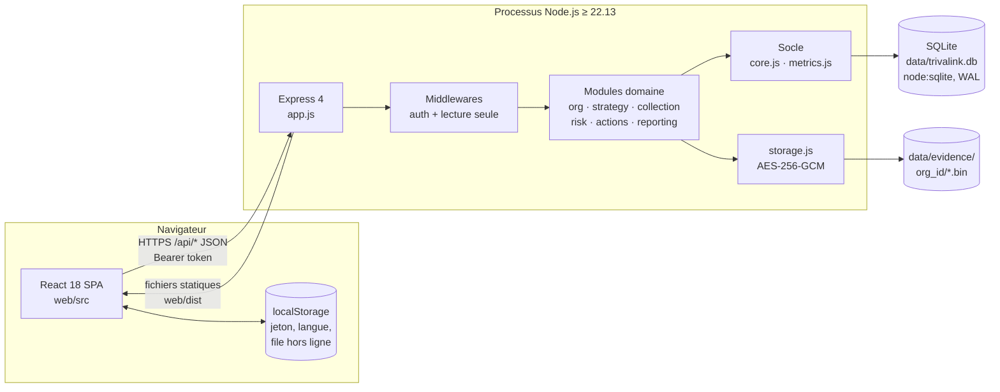
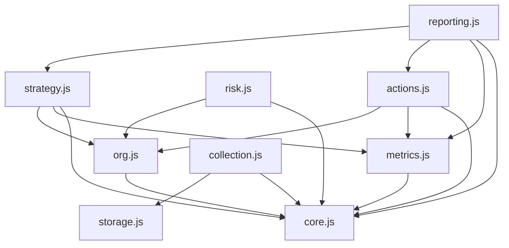
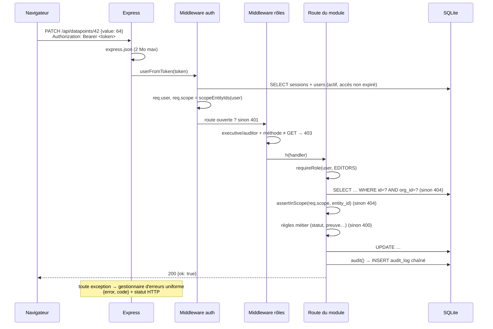
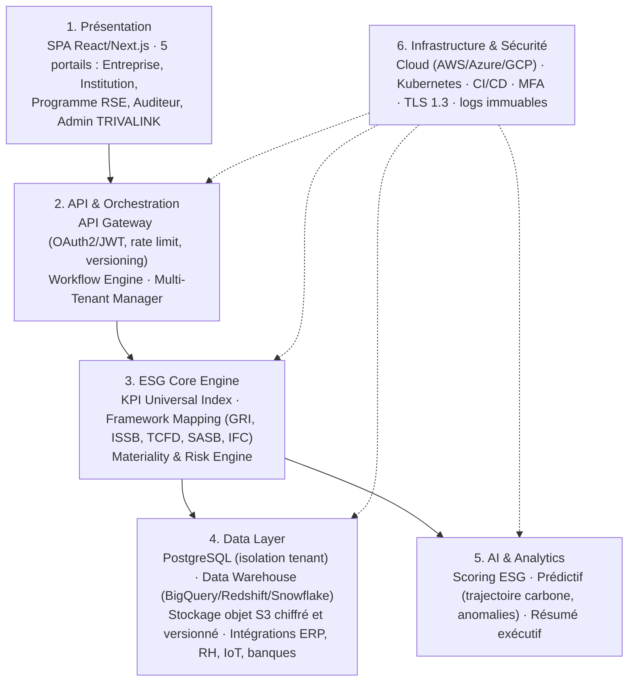

# 03 · Architecture

Deux niveaux : l'**architecture réelle du MVP** (ce que le code fait aujourd'hui) et l'**architecture cible** (DAT / CdC, horizon 12-24 mois). La règle : **chaque évolution du MVP doit rapprocher de la cible sans la précipiter.**

## 1. Vue d'ensemble du MVP



| Couche | Technologie | Version | Rôle |
|---|---|---|---|
| Front | React + Vite | 18.3 / 5.4 | SPA, routage par hash, FR/EN, file hors ligne |
| HTTP | Express | 4.22 | Routage `/api`, JSON, fichiers statiques |
| Upload | multer | 1.4 | Fichiers en mémoire, 20 Mo max |
| Base | `node:sqlite` (`DatabaseSync`) | intégré Node 22.13+ | SQL synchrone, journal WAL, clés étrangères |
| PDF | pdfkit | 0.20 | Rendu des rapports |
| Excel | exceljs | 4.4 | Import `.xlsx` et export des rapports |
| Crypto | `node:crypto` | intégré | scrypt (mots de passe), SHA-256, AES-256-GCM |
| Tests | `node:test` + `fetch` | intégré | Tests d'API de bout en bout |

**Aucune autre dépendance.** C'est un choix : surface d'attaque minimale, installation triviale sur un poste Windows d'une filiale ou un serveur sans Internet. Toute nouvelle dépendance doit être justifiée (voir 12-conventions-code.md).

## 2. Arborescence

```
trivalink/app/
├── package.json            scripts racine : setup, build, start, test, dev:api, dev:web, reset-demo
├── README.md
├── docs/captures/          captures d'écran et exemple de rapport PDF
├── server/
│   ├── package.json        "type": "module" (ESM), dépendances serveur
│   ├── src/
│   │   ├── server.js       point d'entrée : chemins, seed, écoute du port
│   │   ├── app.js          createApp() : Express, authentification, montage des modules, erreurs
│   │   ├── core.js         HttpError, rôles, périmètre, audit chaîné, sessions, périodes, utilitaires
│   │   ├── db.js           schéma SQL complet + helpers q.all/get/run/tx
│   │   ├── metrics.js      consolidation multi-entités, avancement vers cible
│   │   ├── storage.js      chiffrement / déchiffrement des preuves
│   │   ├── catalog.js      44 indicateurs de départ + installCatalog()
│   │   ├── seed.js         jeu de démonstration Kalaya + second client SIL
│   │   └── modules/
│   │       ├── org.js         auth, /me, entités, utilisateurs, politiques
│   │       ├── strategy.js    engagements, objectifs (01)
│   │       ├── collection.js  indicateurs, campagnes, données, validation, preuves, import (02-04)
│   │       ├── risk.js        risques, obligations, écarts, griefs, programmes (05)
│   │       ├── actions.js     plans d'action, résultat mesuré (07)
│   │       └── reporting.js   tableau de bord, rapports IFC/GRI, PDF/Excel, journal d'audit (06)
│   └── test/api.test.js    6 tests de bout en bout
└── web/
    ├── index.html
    ├── vite.config.js      proxy /api → http://localhost:3000 en dev (port 5173)
    └── src/
        ├── main.jsx        montage React
        ├── App.jsx         coque, navigation par rôle, routage par hash, synchro hors ligne
        ├── api.js          client HTTP, téléchargements, file hors ligne
        ├── session.js      contexte de session, helpers de rôle
        ├── i18n.js         dictionnaire FR→EN, libellés de statuts
        ├── ui.jsx          composants partagés (Badge, Modal, Tabs, Stat, EntitySelect…)
        ├── styles.css      jetons de design et styles
        └── pages/          Login, Dashboard, Strategy, Collection, DataPoint, Risks, Actions, Reports, Evidence, Audit, Admin
```

## 3. Le monolithe modulaire

Chaque module exporte une fonction `default (api, ctx)` qui enregistre ses routes sur le routeur Express partagé :

```js
// app.js
const ctx = { db, q, storageDir };
orgModule(api, ctx);
strategyModule(api, ctx);
collectionModule(api, ctx);
riskModule(api, ctx);
actionsModule(api, ctx);
reportingModule(api, ctx);
app.use('/api', api);
```

### Dépendances entre modules (autorisées)



Règles :
- `core.js` et `metrics.js` ne dépendent d'aucun module.
- Un module peut importer une **fonction exportée** d'un autre (`ownerIn`, `objectiveStatus`, `enrichAction`, `objectEntity`) mais **jamais ses routes**.
- `reporting.js` est le seul module « lecteur transverse » : il agrège tout, n'écrit rien d'autre que l'audit.
- Pas de dépendance circulaire. Si deux modules ont besoin de la même logique, elle descend dans `metrics.js` ou `core.js`.

Ce découpage prépare la cible : chaque module deviendra un service (ou un « bounded context ») le jour où la charge ou l'organisation de l'équipe le justifiera.

## 4. Cycle de vie d'une requête



Points clés :
1. **L'organisation vient toujours de la session** (`req.user.org_id`), jamais d'un paramètre.
2. **Un objet hors organisation ou hors périmètre répond 404**, pas 403 : on ne révèle pas son existence.
3. Le wrapper `h()` transmet aux erreurs Express les exceptions synchrones **et** les promesses rejetées.
4. Les accès SQL sont **synchrones** (`DatabaseSync`) : pas d'`await` sur la base, transactions simples via `q.tx(fn)`.

## 5. Gestion des erreurs

`HttpError(status, message, code)` est la seule façon de renvoyer une erreur métier :

| Helper | Statut | `code` | Usage |
|---|---|---|---|
| `bad(msg)` | 400 | `bad_request` | Règle métier violée, champ invalide |
| `forbidden(msg?)` | 403 | `forbidden` | Rôle insuffisant, séparation des tâches |
| `notFound(what?)` | 404 | `not_found` | Objet absent, autre organisation ou hors périmètre |
| `new HttpError(401, …, 'unauthorized')` | 401 | `unauthorized` / `expired` | Session absente, invalide ou expirée |

Traductions automatiques dans `app.js` :
- SQLite `UNIQUE` → **409** `conflict` « Cet élément existe déjà »
- SQLite `CHECK` ou `FOREIGN` → **400** `bad_request` « Valeur invalide »
- JSON mal formé → **400**
- Tout le reste → **500** `internal` (journalisé avec `console.error`)

Format de réponse d'erreur, toujours :

```json
{ "error": "Une pièce justificative est obligatoire pour cet indicateur", "code": "bad_request" }
```

Les messages d'erreur sont **en français et destinés à l'utilisateur final** : l'interface les affiche tels quels dans un toast. [À FAIRE] traduire côté serveur selon `users.lang` ou renvoyer une clé i18n.

## 6. Démarrage et données

`server.js` :
1. calcule `dataDir` = `TRIVALINK_DATA_DIR` ou `trivalink/app/data` ;
2. `createApp({ dbFile: data/trivalink.db, storageDir: data/evidence, webDir: web/dist })` ;
3. `openDb` crée le dossier, active WAL et exécute le schéma (`CREATE TABLE IF NOT EXISTS`) ;
4. si `TRIVALINK_SEED !== '0'` et qu'aucune organisation n'existe, crée la démonstration ;
5. sert `web/dist` et renvoie `index.html` pour toute route non `/api` (SPA) ;
6. écoute sur `PORT` (3000 par défaut).

**Il n'y a pas de système de migrations** : le schéma est idempotent mais ne sait pas modifier une table existante. C'est le premier chantier technique avant d'avoir des données client (voir 16 et ADR-007).

## 7. Architecture cible (DAT / CdC)

Le DAT décrit une « infrastructure d'orchestration ESG multi-tenant, multi-référentiels, auditable, financière et prédictive » en **6 couches** :



Services métiers cibles (CdC §3.3) et leur ancêtre dans le MVP :

| Service cible | Fonctions | Module MVP |
|---|---|---|
| ESG Core Service | KPI, historisation, validation hiérarchique, agrégations | `collection.js` + `metrics.js` |
| Framework Mapping Service | Cross-mapping, structure de rapport, mise à jour réglementaire | colonnes `gri`/`ifc` + `reporting.js` |
| Multi-Tenant Service | Isolation, organisations, hiérarchie, RBAC | `core.js` + `org.js` |
| Program Impact Service | Programmes, bénéficiaires, géolocalisation, budget | `programs` dans `risk.js` |
| Finance & Impact Bridge | ERP, budget ESG, dépenses, SROI, coût carbone | budget/dépensé des actions et programmes |
| Risk & Materiality Engine | Double matérialité, scoring, heatmap, alertes | `risks` (matrice 5x5), seuils |
| Audit & Compliance Service | Journal immuable, versioning, signature de rapports, dossier d'audit | `audit_log` chaîné, empreinte de rapport |
| AI & Predictive Service (Python) | Projection carbone, anomalies, tendances, résumé | absent (phase 2-3) |

### Isolation multi-tenant cible : hybride

- **Option 1, isolation logique** (`org_id` partout, Row-Level Security PostgreSQL) : offres Essentiel et Entreprise. **C'est ce que fait le MVP**, sans RLS.
- **Option 2, base dédiée** : offre Institution, clients publics, exigence contractuelle.

## 8. Trajectoire MVP → cible

| Étape | Déclencheur | Changement | Ce qui ne change pas |
|---|---|---|---|
| T0 (actuel) | — | Monolithe, SQLite, disque local | Contrat d'API, schéma logique |
| T1 Pilotes en production | Premier client réel | PostgreSQL + migrations, S3 compatible, secrets, sauvegardes, MFA, HTTPS, e-mails | Monolithe, modules |
| T2 Entreprise (≈ 12 mois) | 10+ clients, équipe > 5 devs | RLS PostgreSQL, file de tâches (rapports, relances), multi-référentiel, API versionnée `/api/v1` | Monolithe probablement |
| T3 Infrastructure (≈ 24 mois) | Charge, API publique, IA | Extraction de services (Reporting, IA Python), entrepôt de données, Kubernetes | Domaines fonctionnels |

**Ne pas extraire de microservice avant T3** sans décision explicite : le coût opérationnel (déploiements, observabilité, transactions distribuées) dépasse le bénéfice tant que l'équipe est petite. Voir ADR-001.
