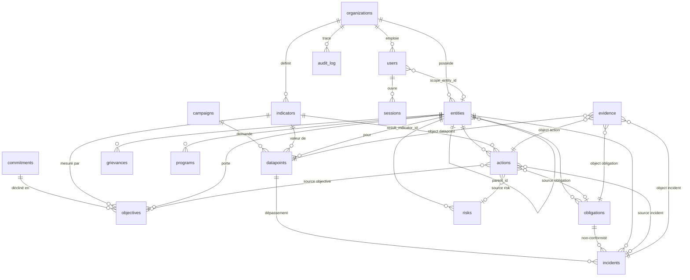
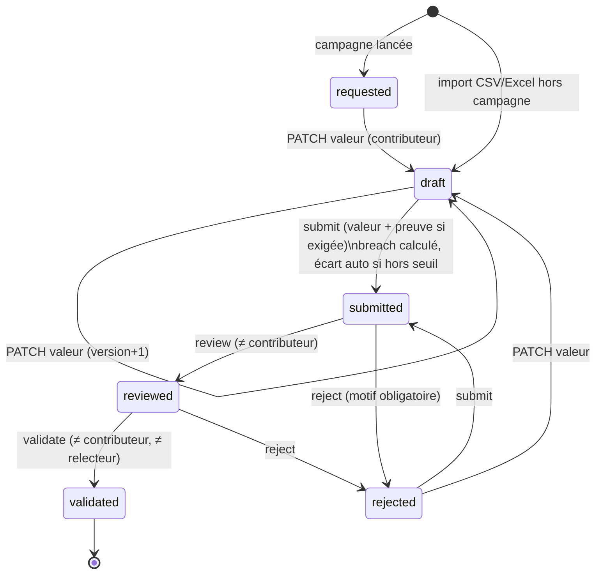
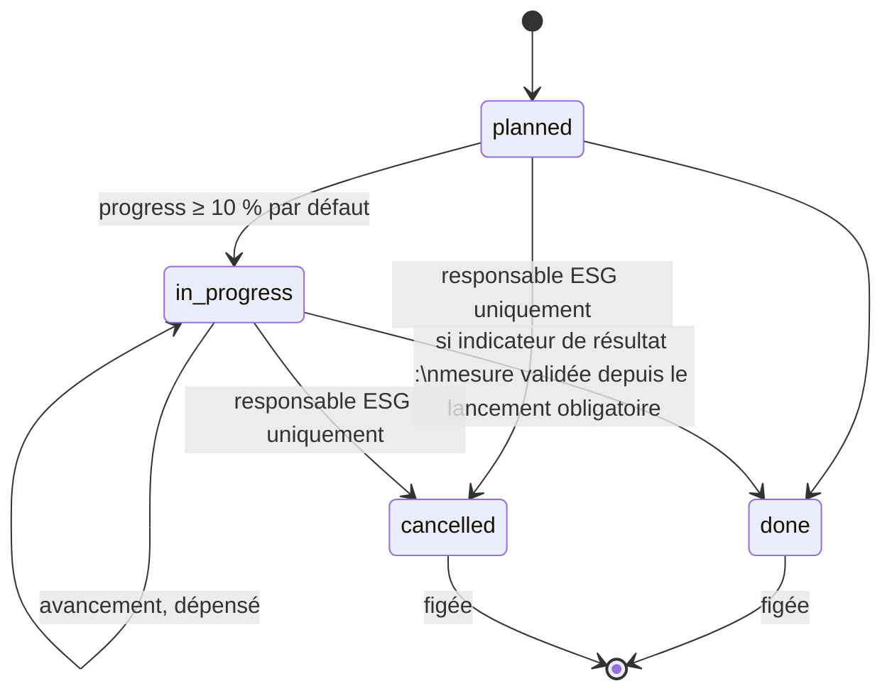
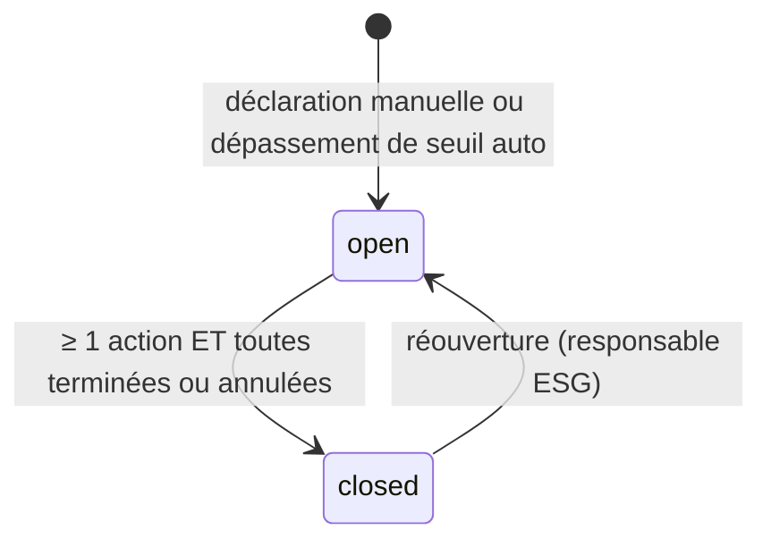

# 04 · Modèle de données

Source de vérité : `server/src/db.js` (constante `SCHEMA`). SQLite pour le MVP, écrit pour être **portable vers PostgreSQL** (types simples, dates en texte ISO 8601, pas de fonctions propriétaires hors `datetime('now')`).

## 1. Principes

1. **Toutes les tables métier portent `org_id`** (sauf `sessions`, rattachée via `users`). C'est la clé d'isolation multi-tenant.
2. **Unicité par organisation** : `UNIQUE (org_id, code)` pour entités et indicateurs ; `UNIQUE (org_id, indicator_id, entity_id, period)` pour les données.
3. **Dates** : texte ISO. Horodatages complets en UTC (`2026-10-08T09:12:00.000Z`) ; dates métier au format `AAAA-MM-JJ` ; `created_at` via `datetime('now')` (format `AAAA-MM-JJ HH:MM:SS`, UTC).
4. **Périodes** : `AAAA-Qn` (trimestre). Comparables lexicographiquement (`'2026-Q3' > '2026-Q2'`).
5. **Énumérations** : contraintes `CHECK (... IN (...))`. Une valeur hors liste → 400 « Valeur invalide ».
6. **Booléens** : `INTEGER` 0/1 (les helpers convertissent `true/false`).
7. **Pas de suppression** : aucune route `DELETE` métier. On clôt, on annule, on désactive (`active = 0`). C'est voulu pour l'auditabilité.
8. **Clés étrangères actives** (`PRAGMA foreign_keys = ON`).

## 2. Diagramme entité-relation



Les liens `actions.source_*` et `evidence.object_*` sont **polymorphes** (type + id), sans clé étrangère SQL : l'intégrité est vérifiée par le code (`SOURCES` dans `actions.js`, `objectEntity()` dans `collection.js`).

## 3. Tables

### 3.1 Socle

#### `organizations`
| Colonne | Type | Contraintes | Notes |
|---|---|---|---|
| id | INTEGER | PK | |
| name | TEXT | NOT NULL | |
| created_at | TEXT | défaut now | |

Aucune route de création : les organisations sont provisionnées par le seed (ou, demain, par une console d'administration TRIVALINK [À FAIRE]).

#### `entities` — hiérarchie groupe → filiale → site
| Colonne | Type | Contraintes | Notes |
|---|---|---|---|
| id | INTEGER | PK | |
| org_id | INTEGER | NOT NULL FK | |
| parent_id | INTEGER | FK entities | NULL pour un groupe |
| name | TEXT | NOT NULL | |
| code | TEXT | NOT NULL, UNIQUE(org_id, code) | Utilisé par l'import CSV (`entity_code`) |
| type | TEXT | `group` \| `subsidiary` \| `site` | |
| country | TEXT | | Code ISO (`GN`, `CI`) |

Règles (`POST /entities`) : un site ne peut pas avoir d'enfant ; une filiale ou un site doit avoir un parent ; un groupe peut ne pas en avoir.

#### `users`
| Colonne | Type | Contraintes | Notes |
|---|---|---|---|
| id | INTEGER | PK | |
| org_id | INTEGER | NOT NULL FK | |
| email | TEXT | NOT NULL **UNIQUE global** | En minuscules. Unicité globale : un e-mail = un client. |
| name | TEXT | NOT NULL | |
| password_hash | TEXT | NOT NULL | `scrypt$<sel hex>$<clé hex>` ; jamais renvoyé (`publicUser`) |
| role | TEXT | 6 valeurs | voir 02-glossaire |
| scope_entity_id | INTEGER | FK entities | NULL = toute l'organisation |
| access_expires_at | TEXT | | `AAAA-MM-JJ`. Obligatoire pour `auditor`. Après cette date : connexion refusée. |
| lang | TEXT | défaut `fr` | `fr` \| `en` |
| active | INTEGER | défaut 1 | Désactiver supprime les sessions |
| created_at | TEXT | défaut now | |

#### `sessions`
| Colonne | Type | Notes |
|---|---|---|
| token | TEXT PK | 32 octets aléatoires en hex (64 caractères) |
| user_id | INTEGER FK | |
| expires_at | TEXT | ISO, création + 12 h |

[À FAIRE] Les sessions expirées ne sont jamais purgées ; stocker un hash du jeton plutôt que le jeton en clair.

### 3.2 Référentiel et Strategy

#### `indicators` — référentiel unique, correspondances multiples
| Colonne | Type | Contraintes | Notes |
|---|---|---|---|
| id | INTEGER | PK | |
| org_id | INTEGER | NOT NULL | **Chaque client a sa copie** du catalogue (`installCatalog`) |
| code | TEXT | UNIQUE(org_id, code) | `E01`…`E20`, `S01`…`S17`, `G01`…`G07` |
| domain | TEXT | `E` \| `S` \| `G` | |
| category | TEXT | NOT NULL | Énergie, Eau, Santé-sécurité… |
| name_fr / name_en | TEXT | NOT NULL | Bilingue en base |
| unit | TEXT | NOT NULL | GJ, m³, tCO2e, %, nb, taux… |
| direction | TEXT | `lower` \| `higher` \| `neutral`, défaut `lower` | |
| aggregation | TEXT | `sum` \| `avg` \| `max`, défaut `sum` | |
| threshold_min / threshold_max | REAL | | Modifiables par client |
| gri | TEXT | | ex. `GRI 303-4`, `GRI 14.5` |
| ifc | TEXT | | ex. `NP3` |
| evidence_required | INTEGER | défaut 1 | Preuve obligatoire à la soumission |
| level | TEXT | `site` \| `group`, défaut `site` | Qui doit fournir la donnée |
| active | INTEGER | défaut 1 | Inactif = exclu des campagnes et du tableau de bord |

[CIBLE] Une table `indicator_mappings (indicator_id, framework, reference, version)` remplacera les colonnes `gri` / `ifc` pour gérer ISSB, TCFD, SASB, ESRS, référentiels nationaux.

#### `commitments`
| Colonne | Type | Notes |
|---|---|---|
| id, org_id | | |
| title | TEXT NOT NULL | |
| description | TEXT | |
| domain | `E`\|`S`\|`G` | |
| source | TEXT | ex. « ESAP IFC », « Politique groupe » |
| owner_id | FK users | |
| created_at | TEXT | |

#### `objectives`
| Colonne | Type | Notes |
|---|---|---|
| id, org_id | | |
| commitment_id | FK NOT NULL | |
| indicator_id | FK NOT NULL | |
| entity_id | FK NOT NULL | La cible porte sur cette entité **et ses descendantes** |
| title | TEXT NOT NULL | |
| baseline_value, baseline_period | REAL, TEXT | Point de départ |
| target_value | REAL NOT NULL | |
| target_period | TEXT NOT NULL | `AAAA-Qn` |

Les champs calculés `current_value`, `current_period`, `progress`, `met` ne sont **pas stockés** : voir `objectiveStatus()` (06-regles-metier.md).

### 3.3 Collecte

#### `campaigns`
| Colonne | Type | Notes |
|---|---|---|
| id, org_id | | |
| name | TEXT NOT NULL | |
| period | TEXT NOT NULL | `AAAA-Qn` |
| deadline | TEXT NOT NULL | `AAAA-MM-JJ` |
| status | `open` \| `closed` | La dernière campagne close définit la période par défaut du tableau de bord |
| created_by, created_at | | |

#### `datapoints` — le cœur de la plateforme
| Colonne | Type | Notes |
|---|---|---|
| id, org_id | | |
| campaign_id | FK nullable | NULL si créée par import hors campagne |
| indicator_id, entity_id | FK NOT NULL | |
| period | TEXT NOT NULL | |
| value | REAL | NULL tant que non saisie |
| comment | TEXT | |
| status | 6 valeurs, défaut `requested` | voir cycle de vie §4.1 |
| version | INTEGER défaut 0 | +1 à chaque modification de valeur |
| submitted_by / submitted_at | | Contributeur |
| reviewed_by / reviewed_at | | Niveau 1 |
| validated_by / validated_at | | Niveau 2 |
| rejection_reason | TEXT | Effacé à la resoumission |
| breach | INTEGER 0/1 | Calculé à la soumission |
| | | **UNIQUE (org_id, indicator_id, entity_id, period)** |

#### `evidence`
| Colonne | Type | Notes |
|---|---|---|
| id, org_id | | |
| object_type | `datapoint` \| `action` \| `obligation` \| `incident` | |
| object_id | INTEGER NOT NULL | Lien polymorphe |
| filename, mime, size | | Nom d'origine (UTF-8) |
| sha256 | TEXT NOT NULL | Empreinte du fichier **en clair** |
| storage_key | TEXT NOT NULL | `<org_id>/<16 premiers car. du sha>-<12 hex aléatoires>.bin` |
| uploaded_by, uploaded_at | | |

Les preuves ne se suppriment pas et ne se remplacent pas : on en ajoute une nouvelle.

### 3.4 Risk & Compliance, Social, Governance

#### `risks`
| Colonne | Notes |
|---|---|
| entity_id, title, category, domain | category libre (ex. « Eau », « Communautés ») |
| likelihood, impact | INTEGER 1 à 5 (`CHECK BETWEEN 1 AND 5`) |
| mitigation | Mesure d'atténuation |
| owner_id | |
| status | `open` \| `mitigated` \| `closed` |

Score = `likelihood × impact` (1 à 25), calculé en SQL à la lecture. **Risque élevé : score ≥ 15** et non clos.

#### `obligations`
| Colonne | Notes |
|---|---|
| entity_id, source, reference, title | source ex. `ESAP IFC`, `Code minier`, `Permis environnemental` ; reference ex. `ESAP-07` |
| due_date | `AAAA-MM-JJ` |
| status | `not_started` \| `in_progress` \| `compliant` \| `non_compliant` |
| owner_id | |

#### `incidents` (écarts)
| Colonne | Notes |
|---|---|
| entity_id, type, severity, title, description | type : `incident`, `audit_finding`, `non_conformity`, `threshold_breach` |
| occurred_at | `AAAA-MM-JJ` |
| status | `open` \| `closed` ; `closed_at` |
| datapoint_id | Rempli pour un dépassement de seuil automatique |
| obligation_id | Rempli pour une non-conformité liée |
| created_by, created_at | |

#### `grievances`
| Colonne | Notes |
|---|---|
| entity_id, received_at, channel, category, description | channel ex. « Registre communautaire », « Téléphone » |
| status | `received` \| `investigating` \| `resolved` \| `closed` |
| resolution, resolved_at | Résolution obligatoire pour `resolved` / `closed` |

#### `programs`
| Colonne | Notes |
|---|---|
| entity_id, name | |
| budget, spent | REAL, devise implicite USD [À FAIRE colonne `currency`] |
| beneficiaries_target, beneficiaries_actual | INTEGER |
| status | `planned` \| `active` \| `completed` |

#### `policies`
| Colonne | Notes |
|---|---|
| title, owner_id, approved_at, review_due | **Pas d'`entity_id`** : visibles par toute l'organisation |

### 3.5 Actions

#### `actions`
| Colonne | Type | Notes |
|---|---|---|
| entity_id | FK NOT NULL | |
| title, description | | |
| source_type, source_id | `incident` \| `obligation` \| `risk` \| `objective` | Lien polymorphe vers l'origine |
| owner_id | FK users | |
| due_date | TEXT NOT NULL | |
| budget, spent | REAL défaut 0 | |
| status | `planned` \| `in_progress` \| `done` \| `cancelled` | |
| progress | INTEGER 0-100 | Forcé à 100 à la clôture |
| result_indicator_id | FK indicators | Indicateur dont l'évolution prouve l'effet |
| baseline_value | REAL | Si absent à la création : dernière valeur validée sur le périmètre |
| target_value | REAL | |
| result_value, result_period | | **Figés à la clôture** |
| closed_at, created_at | | |

Champs calculés à la lecture (`enrichAction`) : `overdue`, `source_title`, `result { measured_value, measured_period, progress, achieved, … }`.

### 3.6 Piste d'audit

#### `audit_log` — ajout seul
| Colonne | Notes |
|---|---|
| id | Ordre de la chaîne |
| org_id | Une chaîne **par organisation** |
| at | ISO UTC |
| user_id, user_name | `user_name` dénormalisé (survit à un renommage) ; `system`/`Initialisation` pour le seed |
| action | `login`, `create`, `update`, `launch`, `submit`, `review`, `validate`, `reject`, `attach_evidence`, `download_evidence`, `import`, `auto_create`, `close`, `generate_report`, `provision` |
| object_type, object_id | ex. `datapoint`, 42 |
| details | JSON texte (avant/après, motif, empreinte…) |
| prev_hash | Hash de la ligne précédente de l'organisation, `GENESIS` pour la première |
| hash | `SHA-256(org_id|at|user_id|action|object_type|object_id|details|prev_hash)` |

Triggers `audit_log_no_update` et `audit_log_no_delete` : toute tentative lève `audit_log is append-only`.

### 3.7 Index

```sql
CREATE INDEX idx_dp_org_period ON datapoints(org_id, period);
CREATE INDEX idx_audit_org ON audit_log(org_id, id);
CREATE INDEX idx_evidence_obj ON evidence(org_id, object_type, object_id);
```

[À FAIRE] avant 100 000 lignes : index `(org_id, indicator_id, status, period)` sur `datapoints`, `(org_id, entity_id)` sur `actions`, `incidents`, `risks`, `obligations` ; `(org_id, source_type, source_id)` sur `actions`.

## 4. Cycles de vie

### 4.1 Donnée (`datapoints.status`)



- Modifiable (valeur, preuve, import) uniquement en `requested`, `draft`, `rejected`.
- **Une donnée validée est définitive.** [À FAIRE] procédure de correction : nouvelle version avec motif, revalidation, traçabilité de l'ancienne valeur.

### 4.2 Action



### 4.3 Écart



### 4.4 Obligation

`not_started` ↔ `in_progress` ↔ `non_compliant` ↔ `compliant` (transitions libres pour un responsable ESG) ; **`compliant` exige au moins une preuve attachée à l'obligation**.

### 4.5 Grief

`received` → `investigating` → `resolved` → `closed` (transitions libres) ; `resolved` et `closed` exigent une résolution ; `resolved_at` est posé une seule fois.

## 5. Portage vers PostgreSQL (checklist)

| SQLite (MVP) | PostgreSQL |
|---|---|
| `INTEGER PRIMARY KEY` | `BIGINT GENERATED ALWAYS AS IDENTITY` |
| `TEXT` dates | `timestamptz` pour horodatages, `date` pour dates métier ; garder `period` en `text` (ou `char(7)`) |
| `REAL` | `numeric(20,6)` pour les valeurs d'indicateurs et montants (pas de flottants pour la finance) |
| `INTEGER` 0/1 | `boolean` |
| `datetime('now')` | `now()` |
| `CHECK (x IN (...))` | conserver, ou types `ENUM` |
| Triggers `RAISE(ABORT)` | `CREATE RULE … DO INSTEAD NOTHING` ou trigger `RAISE EXCEPTION`, plus `REVOKE UPDATE, DELETE` sur le rôle applicatif |
| `INSERT OR IGNORE` | `INSERT … ON CONFLICT DO NOTHING` |
| `lastInsertRowid` | `RETURNING id` |
| `changes` | `rowCount` |
| Filtrage `org_id` applicatif | + **Row-Level Security** : `USING (org_id = current_setting('app.org_id')::bigint)` |
| Chaîne d'audit (dernier hash) | Sérialiser par organisation : `pg_advisory_xact_lock(org_id)` dans la transaction d'écriture |
| `DatabaseSync` synchrone | Pilote asynchrone (`pg`) : toutes les fonctions deviennent `async` ; prévoir le refactor de `h()`, `q.tx()` et des helpers |
