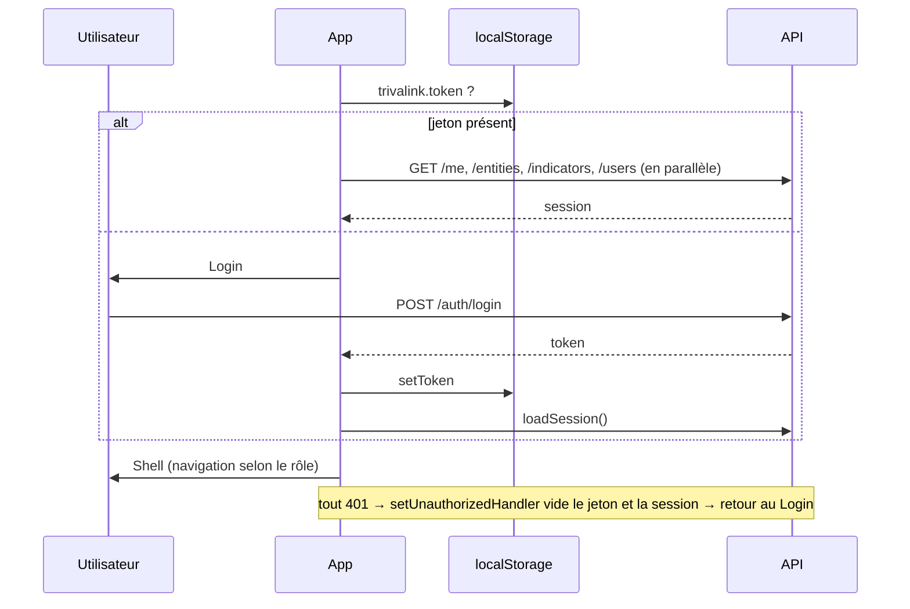

# 08 · Front-end

Application **React 18** (JavaScript, JSX), construite avec **Vite 5**, sans bibliothèque d'état, de routage ni de composants externes. Volontairement simple : un développeur (ou une IA) lit tout le front en une heure.

## 1. Démarrage

| Mode | Commande | URL |
|---|---|---|
| Développement (rechargement à chaud) | `npm run dev:api` + `npm run dev:web` (deux terminaux) | http://localhost:5173 (proxy `/api` → 3000) |
| Production locale | `npm run build` puis `npm start` | http://localhost:3000 (Express sert `web/dist`) |

## 2. Organisation des fichiers

```
web/src/
├── main.jsx        createRoot + StrictMode + styles.css
├── App.jsx         App (langue, session, démarrage) → Shell (menu, barre, routage, hors ligne)
├── api.js          api(), download(), file hors ligne, saveDatapoint/uploadEvidence/submitDatapoint, syncQueue
├── session.js      SessionContext, useSession, go(), isManager(), isReadOnly()
├── i18n.js         dictionnaire EN, LangContext, useT, makeT, libellés (rôles, statuts, types, gravités, domaines)
├── ui.jsx          composants partagés + hooks (useLoad, useForm, useToast)
├── styles.css      jetons CSS + tous les styles (≈ 16 Ko)
└── pages/
    ├── Login.jsx       connexion + comptes de démo cliquables
    ├── Dashboard.jsx   tableau de bord consolidé ; exporte PeriodSelect
    ├── Strategy.jsx    engagements, objectifs, avancement
    ├── Collection.jsx  Mes saisies · À valider · Campagnes · Données de la période · Importer
    ├── DataPoint.jsx   fiche d'une donnée : valeur, preuves, historique, écarts
    ├── Risks.jsx       Écarts · Obligations · Risques · Griefs · Programmes · Politiques
    ├── Actions.jsx     Mes actions · En cours · En retard · Terminées ; exporte ActionForm
    ├── Reports.jsx     choix IFC/GRI, entité, période ; aperçu ; PDF/Excel
    ├── Evidence.jsx    bibliothèque des preuves
    ├── Audit.jsx       journal d'audit + vérification de la chaîne
    └── Admin.jsx       Utilisateurs · Entités · Indicateurs (seuils)
```

## 3. Cycle de vie de l'application



La **session** (contexte React) contient : `user`, `org`, `scope`, `entities`, `indicators`, `users`, et `refresh()` pour la recharger après une modification d'administration.

## 4. Routage

Routage **par hash**, maison (`App.jsx` `parseHash`) : `#/page/id`.

| Hash | Page | Rôles (menu) |
|---|---|---|
| `#/dashboard` | Dashboard | tous |
| `#/strategy` | Strategy | A, M, E, Au |
| `#/collection` | Collection | A, M, C, Au |
| `#/datapoint/:id` | DataPoint | tous (accès via un lien) |
| `#/risks` | Risks | tous |
| `#/actions` ou `#/actions/:id` | Actions (`focus` = id ouvert) | tous |
| `#/reports` | Reports | A, M, E, Au |
| `#/evidence` | Evidence | tous |
| `#/audit` | Audit | A, M, E, Au |
| `#/admin` | Admin | A, M |

- Le menu est la constante `NAV` : `[clé, libellé FR, chemin SVG de l'icône, rôles autorisés | null]`.
- Une page non autorisée pour le rôle affiche le tableau de bord. **Ce n'est pas une sécurité** : le serveur refuse de toute façon (403/404).
- Page d'accueil : `contributor` → collecte ; `action_owner` → actions ; autres → tableau de bord.
- Naviguer en code : `go('actions/12')` (de `session.js`).

**Ajouter une page** : créer `pages/MaPage.jsx` (export default), l'importer dans `App.jsx`, ajouter une entrée dans `NAV` et une branche dans la chaîne `if (page === …)`, ajouter les libellés dans `i18n.js`.

## 5. Appels à l'API

```js
import { api, download } from '../api.js';

const risks = await api('/risks');                                   // GET
await api('/risks', { method: 'POST', body: { title, … } });        // JSON
await api('/evidence', { method: 'POST', form: formData });         // multipart
await download(`/reports/ifc?period=2026-Q2&format=pdf`, 'rapport.pdf'); // fichier authentifié
```

- `api()` ajoute le jeton, sérialise le JSON, lève `ApiError(status, message)` avec le message serveur, ou `OfflineError` si `fetch` échoue (réseau).
- Le message d'erreur serveur est déjà rédigé pour l'utilisateur : l'afficher tel quel (`toast(e.message, 'red')` ou `<ErrorBox error={e} />`).

### Charger des données dans un composant

```jsx
const { data, error, loading, reload } = useLoad(() => api(`/dashboard?${qs}`), [entity, period]);
if (error) return <ErrorBox error={error} />;
if (!data) return <Loading />;
```

`useLoad(fn, deps)` relance `fn` quand `deps` change ; `reload()` après une écriture.

## 6. Mode hors ligne (saisie de site)

Exigence produit : « Saisie terrain tolérante aux coupures ». Implémenté dans `api.js` pour **les trois opérations de saisie d'une donnée** :

| Fonction | En ligne | Hors ligne (`OfflineError`) |
|---|---|---|
| `saveDatapoint(id, value, comment)` | `PATCH /datapoints/:id` | file `{kind:'save', id, value, comment}` |
| `uploadEvidence('datapoint', id, file)` | `POST /evidence` | fichier converti en data URL, file `{kind:'evidence', id, name, data}` ; **refus au-delà de 3 Mo** (quota `localStorage`) |
| `submitDatapoint(id)` | `POST /datapoints/:id/submit` | file `{kind:'submit', id}` |

- La file vit dans `localStorage['trivalink.offlineQueue']` et survit à la fermeture du navigateur.
- `syncQueue()` rejoue **dans l'ordre**, opération par opération. Si le réseau retombe, il s'arrête et garde la suite. Si le serveur **refuse** une opération (règle métier), elle est retirée et l'erreur est affichée en toast rouge.
- Déclencheurs de synchronisation : événement `online`, démarrage de l'application si la file n'est pas vide, bouton « Synchroniser ».
- La barre supérieure affiche « Hors ligne » et « N opération(s) en attente de synchronisation ».
- Seules les opérations de saisie sont mises en file. Les autres écritures (actions, écarts…) échouent proprement hors ligne.

Limites connues et évolutions [À FAIRE] :
1. Les **lectures** ne sont pas en cache : l'écran de saisie doit avoir été chargé en ligne. → Service Worker + cache des listes `queue=todo` (PWA installable sur tablette).
2. `localStorage` (≈ 5 Mo) limite les preuves en attente. → IndexedDB pour les fichiers.
3. Pas de détection de conflit (donnée validée entre-temps). → Le serveur refuse déjà (RG-22) ; afficher un écran de résolution.
4. Pas d'identifiant d'idempotence : un `submit` rejoué deux fois renvoie 400 la seconde fois (sans dommage).

## 7. Internationalisation

**Le français est la clé.** Tout texte s'écrit en français dans le JSX, enveloppé par `t()` ; l'anglais vient du dictionnaire `EN` de `i18n.js`.

```jsx
const { t, lang } = useT();
<h1>{t('Tableau de bord')}</h1>
<td>{lang === 'en' ? ind.name_en : ind.name_fr}</td>      // données bilingues en base
<Badge status={dp.status} />                                // libellé via STATUS_LABEL puis t()
```

- Clé absente du dictionnaire → le français s'affiche (pas d'erreur). **Vérifier en EN avant chaque PR.**
- Dictionnaires de libellés partagés : `ROLE_LABEL`, `STATUS_LABEL`, `INCIDENT_TYPE`, `SEVERITY`, `DOMAIN`, `ENTITY_TYPE`.
- Langue : `localStorage['trivalink.lang']`, sinon `users.lang`, sinon `fr`. Le changement est envoyé au serveur (`PATCH /me`).
- Nombres : `fmt(v, lang)` (séparateurs `fr-FR` / `en-GB`, 0 décimale au-delà de 100, 2 sinon, `–` si vide). Périodes affichées `2026 T3` en FR.
- [À FAIRE] Quand le dictionnaire dépassera ~500 entrées : passer à des clés neutres (`dashboard.title`) et des fichiers `fr.json`/`en.json`, avec un test qui détecte les clés manquantes.

## 8. Composants partagés (`ui.jsx`)

| Composant / hook | Usage |
|---|---|
| `useLoad(fn, deps)` | Chargement asynchrone `{data, error, loading, reload}` |
| `useForm(initial)` | `{values, setValues, bind(k)}` ; `bind` renvoie `{value, onChange}` |
| `useToast()` | `toast(texte, ton)` ; ton `green` (défaut), `red`, `amber` ; disparaît après 4,5 s |
| `<Badge status="validated" />` | Pastille colorée selon le statut (table `TONE`) ; `tone` force la couleur |
| `<Modal title onClose wide>` | Fenêtre modale, fermeture Échap et clic extérieur |
| `<Field label hint>` | Libellé + champ + aide |
| `<Tabs tabs={[[clé, libellé, compteur?]]} value onChange>` | Onglets accessibles (`role="tab"`) |
| `<Stat label value sub tone>` | Tuile d'indicateur clé |
| `<Progress value tone>` | Barre 0-100 (`role="progressbar"`) |
| `<EntitySelect entities value onChange allowAll filter>` | Liste hiérarchique indentée des entités |
| `<ErrorBox error>`, `<Loading>`, `<Empty>` | États |
| `fmt(v, lang, digits)`, `today()` | Formatage |

Couleurs de statut (`TONE`) : vert = validé/conforme/terminé ; bleu = en cours de traitement ; ambre = brouillon/ouvert/reçu ; rouge = rejeté/non conforme ; gris = demandé/planifié/annulé/clos.

## 9. Écrans clés et comportements à préserver

- **Collecte › Mes saisies** (`EntryRow`) : saisie en ligne dans un tableau ; la ligne passe en alerte si la valeur sort des seuils **avant** soumission ; le bouton 📎 est orange si une preuve est exigée et absente, vert si présente ; « Soumettre » enregistre d'abord si la valeur a changé ; toast ambre « Dépassement de seuil détecté : un écart a été créé. »
- **Collecte › À valider** : file `submitted` + `reviewed` ; boutons « Revoir (niveau 1) », « Valider (niveau 2) », « Rejeter » (motif) ; les erreurs de séparation des tâches s'affichent telles quelles.
- **Tableau de bord** : filtres entité + période ; tuiles (données validées, taux de preuve, écarts ouverts, actions en retard, obligations conformes, risques élevés) ; onglets E/S/G avec compteur de dépassements ; matrice des risques 5×5 ; alertes et écarts ouverts ; avancement des objectifs.
- **Risques et conformité** : depuis un écart, une obligation ou un risque, bouton « Créer une action » qui pré-remplit l'origine (`ActionForm` avec `initial`).
- **Actions** : la fiche affiche le résultat mesuré (départ → mesure → cible, atteint ou non) ; la clôture refusée affiche le message serveur sur la mesure manquante.
- **Rapports** : aperçu JSON rendu en HTML, empreinte affichée, téléchargement PDF / Excel via `download()`.
- **Journal d'audit** : filtre par type d'objet, bouton « Vérifier la chaîne » (vert « Chaîne intègre » / rouge « Chaîne rompue »).

## 10. Responsive et accessibilité

- Points de rupture : 1200 px (tuiles 3 colonnes), 960 px, 760 px (menu latéral en tiroir via le bouton ☰).
- Les écrans de saisie doivent rester utilisables sur **tablette 10 pouces** et smartphone (contributeurs de site) : champs numériques avec `inputMode="decimal"`.
- Cible CdC : **WCAG 2.1**. Déjà présent : `aria-label` sur les boutons-icônes, `role="tab"`, `role="dialog"`, `role="progressbar"`, focus visible. [À FAIRE] audit axe-core, contraste des badges, navigation complète au clavier dans les tableaux de saisie, piège de focus dans les modales.

## 11. Évolutions recommandées du front (par ordre)

1. **TypeScript** (CdC) progressivement : `// @ts-check` + JSDoc, puis `.tsx` page par page ; types générés depuis le contrat OpenAPI.
2. **PWA** : Service Worker, manifeste, cache des écrans de saisie, IndexedDB pour la file.
3. **Tests front** : Vitest + Testing Library pour `api.js` (file hors ligne) et `EntryRow` ; Playwright pour le scénario de bout en bout.
4. **Graphiques** : séries temporelles des KPI (le CdC cite ECharts/D3) ; garder une bibliothèque unique et légère.
5. **Thème par client** (CdC « système de thème par entreprise ») : surcharger les variables CSS `--brand`, `--accent` depuis un paramètre d'organisation.
6. Ne pas migrer vers Next.js tant que le rendu serveur n'apporte rien (application authentifiée, pas de SEO).
