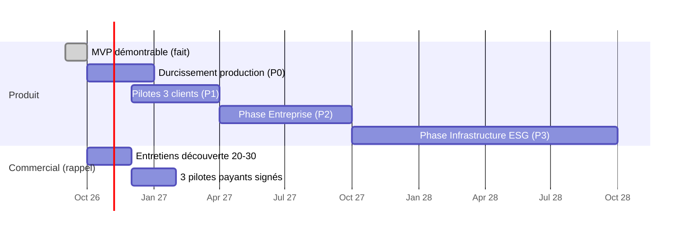

# 14 · Roadmap et backlog

Le backlog est écrit en **user stories avec critères d'acceptation testables**, directement utilisables comme prompt pour un assistant IA (voir 15). Identifiants : `TL-<epic>-<n>`. Priorités : **P0** avant le premier pilote en production, **P1** pendant les pilotes, **P2** phase Entreprise (≈ 12 mois), **P3** phase Infrastructure (≈ 24 mois).

## 1. Feuille de route

Dates indicatives : le plan produit prévoit ≈ 12 semaines de MVP puis des pilotes ; le contenu final dépend des entretiens clients.

| Phase | Objectif | Contenu clé |
|---|---|---|
| **P0 Durcissement** | Héberger les données d'un vrai client sans risque | PostgreSQL + migrations, stockage objet, secrets, HTTPS, MFA, rate limiting, sauvegardes, CI, e-mails |
| **P1 Pilotes** | Atteindre les critères de sortie du MVP (01 §7) | Relances, correction de données validées, indicateurs calculés, seuils par site, PWA hors ligne, dossier d'audit, ajustements demandés par les pilotes |
| **P2 Entreprise** | 10 clients, offre Essentiel pour sous-traitants | Multi-référentiel (ISSB, TCFD, SASB), double matérialité, Finance Bridge, signature des rapports, API v1, SSO, offres et feature flags |
| **P3 Infrastructure** | Référence ESG africaine | IA (projection carbone, anomalies, résumé exécutif), connecteurs ERP/IoT, API publique, entrepôt et benchmark, portail Institution multi-organisations, XBRL |

## 2. Epics et user stories

### EPIC PROD · Passage en production (P0)

**TL-PROD-1 · Base PostgreSQL et migrations**
En tant qu'exploitant, je veux que TRIVALINK tourne sur PostgreSQL avec des migrations versionnées, afin de faire évoluer le schéma sans perdre de données client.
- [ ] Toutes les tables de 04 portées (types : voir 04 §5) dans `migrations/001_init.sql`.
- [ ] Une table `schema_migrations` ; migrations appliquées au démarrage, dans une transaction.
- [ ] Couche d'accès asynchrone ; tous les tests existants passent sur PostgreSQL (conteneur en CI).
- [ ] La chaîne d'audit est sérialisée par organisation (`pg_advisory_xact_lock`).
- [ ] SQLite reste possible pour le développement local, ou est retiré par décision explicite (ADR).

**TL-PROD-2 · Stockage objet des preuves**
- [ ] Interface `storage` inchangée (`saveFile`, `readFile`) avec deux implémentations : disque (dev) et S3 compatible (prod).
- [ ] Chiffrement côté application conservé ; versioning et Object Lock activés côté bucket.
- [ ] L'empreinte SHA-256 est revérifiée au téléchargement ; écart → 500 + alerte.

**TL-PROD-3 · Secrets et configuration**
- [ ] Le serveur refuse de démarrer en `NODE_ENV=production` sans `TRIVALINK_STORAGE_KEY` ou avec la valeur par défaut.
- [ ] La démo ne peut pas être créée en production.
- [ ] Configuration centralisée (`config.js`) validée au démarrage.

**TL-PROD-4 · MFA TOTP**
En tant que responsable ESG d'un client Entreprise, je veux une double authentification, afin de protéger les données de mon groupe.
- [ ] Enrôlement TOTP (QR code), 10 codes de secours hachés.
- [ ] Connexion en deux étapes ; jeton intermédiaire limité à `/auth/mfa`.
- [ ] Activation obligatoire configurable par organisation.
- [ ] Événements `mfa_enroll`, `mfa_success`, `mfa_failure` tracés.

**TL-PROD-5 · Sessions durcies**
- [ ] Jeton stocké haché ; purge des sessions expirées ; expiration glissante (2 h d'inactivité) et absolue (12 h).
- [ ] Jeton en query string refusé.
- [ ] Limitation : 5 échecs de connexion / 15 min par compte et par IP.

**TL-PROD-6 · Réinitialisation de mot de passe et invitation par e-mail**
- [ ] Création d'utilisateur par invitation (lien à usage unique, 72 h) au lieu d'un mot de passe saisi par l'administrateur.
- [ ] Mot de passe oublié (lien 30 min) ; réponses identiques que l'e-mail existe ou non.

**TL-PROD-7 · Intégration continue**
- [ ] GitHub Actions : `npm ci`, lint, tests, build, `npm audit` ; sur PostgreSQL.
- [ ] Déploiement automatique sur staging à la fusion dans `main`.

**TL-PROD-8 · Observabilité**
- [ ] Journaux structurés JSON avec identifiant de requête ; métriques (latence, erreurs, durée de génération des rapports) ; alertes.
- [ ] Sonde `/api/health` qui vérifie la base et le stockage.

### EPIC COLL · Collecte (P1)

**TL-COLL-1 · Relances automatiques**
En tant que responsable ESG, je veux que les contributeurs soient relancés avant l'échéance, afin de ne pas courir après les données.
- [ ] E-mail J-7 et J-1 aux contributeurs ayant des données `requested`/`draft`/`rejected` dans une campagne ouverte ; récapitulatif J+1 au responsable ESG.
- [ ] E-mail au contributeur à chaque rejet (avec le motif).
- [ ] Langue de l'e-mail = `users.lang`. Désinscription impossible pour les relances obligatoires, possible pour les récapitulatifs.

**TL-COLL-2 · Correction d'une donnée validée** (Q2 de 06)
- [ ] `POST /datapoints/:id/reopen` (A/M), motif obligatoire → statut `draft`, `version + 1`, ancienne valeur et validateurs conservés dans l'audit.
- [ ] Les rapports déjà générés gardent leur empreinte ; un nouveau rapport a une empreinte différente.
- [ ] L'écran de la donnée affiche toutes les versions.

**TL-COLL-3 · Indicateurs calculés** (Q1)
- [ ] Colonne `formula` ; S06 (LTIFR) = S05 × 10⁶ / S04, S07 recalculé, E07 sur production.
- [ ] Consolidation : les composantes sont consolidées puis la formule appliquée.
- [ ] Un indicateur calculé n'est pas saisi.

**TL-COLL-4 · Seuils par entité** (Q8)
- [ ] Table `indicator_thresholds` ; priorité seuil d'entité > seuil d'indicateur ; source du seuil (permis, ESAP) affichée.

**TL-COLL-5 · Hors ligne complet (PWA)**
- [ ] Application installable ; écran « Mes saisies » consultable sans réseau après un premier chargement.
- [ ] Preuves en attente dans IndexedDB (limite 50 Mo) ; photos prises depuis la tablette compressées.
- [ ] Écran de conflits si une opération est refusée au rejeu.

**TL-COLL-6 · Créer un indicateur propre au client**
- [ ] `POST /api/indicators` (A/M) ; code préfixé ; FR + EN obligatoires ; audit.

**TL-COLL-7 · Fréquences mensuelle et annuelle** (Q5).

### EPIC RISK · Risques et conformité

**TL-RISK-1 · Double matérialité** (P2) — enjeux, impact sur l'entreprise × impact de l'entreprise, matrice, lien enjeu → engagement → indicateur.
**TL-RISK-2 · Échéances d'obligations** (P1) — obligations en retard au tableau de bord ; relance au responsable.
**TL-RISK-3 · Registre des contrôles internes** (P2) — contrôles, fréquence, résultat, écart automatique si contrôle non conforme.
**TL-RISK-4 · Griefs : délais de traitement** (P1) — délai cible par catégorie, calcul automatique de S13 (« griefs traités dans les délais ») à partir du registre.
**TL-RISK-5 · Programmes : alimentation automatique** (P1) — S14 et S15 proposés à partir des programmes.

### EPIC ACT · Actions

**TL-ACT-1 · Notifications d'actions** (P1) — assignation, J-7 avant échéance, retard.
**TL-ACT-2 · Commentaires et pièces dans le fil d'une action** (P1).
**TL-ACT-3 · Finance Bridge** (P2) — budget ESG par entité et par année, dépenses réelles, coût carbone interne, SROI ; import des dépenses depuis l'ERP.

### EPIC REP · Reporting

**TL-REP-1 · Dossier d'audit exportable** (P1)
En tant qu'auditeur, je veux télécharger un dossier complet, afin de vérifier hors ligne.
- [ ] ZIP : rapport PDF + Excel, toutes les preuves des données validées du périmètre et de la période (noms explicites), extrait du journal, résultat de `verify`, manifeste des empreintes.
- [ ] Génération asynchrone si > 30 s.

**TL-REP-2 · Section NP6 biodiversité dans le rapport IFC** (P1).
**TL-REP-3 · Index GRI conforme** (P1) — déclaration d'usage, emplacement, omissions.
**TL-REP-4 · Rapport de programme RSE** (P1).
**TL-REP-5 · Multi-référentiel ISSB / IFRS S2, TCFD, SASB** (P2) — table `indicator_mappings`, rapports correspondants.
**TL-REP-6 · Signature numérique des rapports** (P2).
**TL-REP-7 · Graphiques d'évolution** (P1) — séries trimestrielles par KPI et par entité.
**TL-REP-8 · Export XBRL** (P3).

### EPIC ORG · Organisation et plateforme

**TL-ORG-1 · Console Administrateur TRIVALINK** (P1) — provisionnement d'organisation (catalogue, premier administrateur), offres, aucun accès aux données sans « break-glass » tracé.
**TL-ORG-2 · Offres et feature flags** (P2) — Essentiel (1 entité), Entreprise, Institution.
**TL-ORG-3 · Thème par client** (P2).
**TL-ORG-4 · SSO OIDC / SAML** (P2).
**TL-ORG-5 · Portail Institution** (P3) — consolidation multi-organisations avec consentement de chaque organisation.
**TL-ORG-6 · API publique v1** (P3) — OpenAPI, clés d'API par organisation, quotas.

### EPIC AI · Intelligence (P3)

**TL-AI-1 · Détection d'anomalies à la soumission** — écart à la tendance de l'entité (> 3 écarts-types) → avertissement au contributeur et au relecteur, jamais de blocage.
**TL-AI-2 · Résumé exécutif** — synthèse en FR/EN générée à partir du JSON du rapport, relue et validée par un humain, marquée comme générée.
**TL-AI-3 · Projection de trajectoire carbone** — à partir des séries validées et des actions planifiées.
**TL-AI-4 · Aide à l'import** — correspondance automatique des colonnes d'un Excel client vers les codes d'indicateurs.

Règle pour toute fonctionnalité IA : **l'IA propose, un humain valide, l'audit trace**. Aucune valeur générée par IA n'entre dans une consolidation sans validation à deux niveaux.

## 3. Dette technique connue

| # | Dette | Impact | Epic |
|---|---|---|---|
| D1 | Pas de migrations | Bloquant pour des données client | PROD-1 |
| D2 | SQLite, accès synchrone | Une seule instance | PROD-1 |
| D3 | `buildDashboard` fait ≈ 90 requêtes par appel | Performance à grande échelle | REP |
| D4 | Moyenne simple pour les ratios | Chiffres consolidés approximatifs | COLL-3 |
| D5 | Messages d'erreur serveur en français seulement | Utilisateurs anglophones | — |
| D6 | `GET /users` non restreint | Exposition d'e-mails | PROD |
| D7 | Pas de lint ni de CI | Qualité | PROD-7 |
| D8 | Dictionnaire i18n à clés françaises | Maintenance au-delà de 500 libellés | — |
| D9 | Pas de TypeScript | Robustesse (exigence CdC) | — |
| D10 | `PATCH /me` interdit aux rôles lecture seule | Langue non enregistrée côté serveur pour E/Au | — |

## 4. Décisions produit en attente qui bloquent du développement

| Décision | Bloque | Responsable |
|---|---|---|
| Hébergement (cloud international vs local / régional) pour les pilotes | PROD-1, PROD-2 | Fondateurs + pilotes |
| Contenu exact du MVP après les entretiens | P1 | Produit |
| Liste des rapports exigés par les prêteurs des pilotes | REP | Produit + pilotes |
| Construction : équipe interne, prestataire ou mixte | Organisation | Fondateurs |
| Disponibilité de la marque TRIVALINK (OAPI) | Identité visuelle, domaine, e-mails | Fondateurs |
