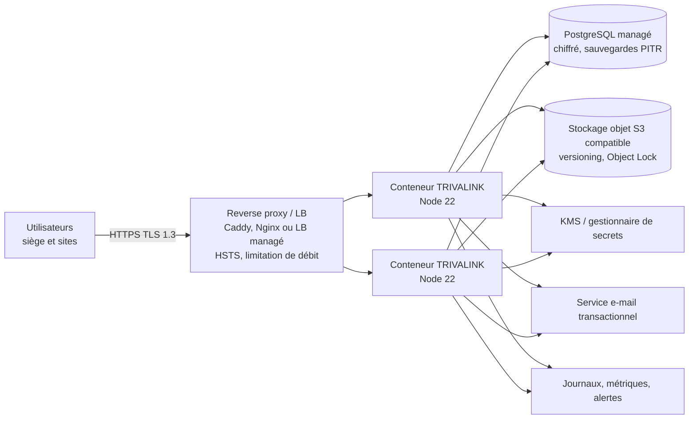

# 16 · Déploiement et exploitation

Le MVP tourne sur un poste de développement. Ce fichier décrit **comment l'héberger pour un pilote** (cible T1 de 03 §8) puis la cible du CdC. Rien ici n'est encore implémenté, sauf mention contraire.

## 1. Environnements (CdC §8)

| Environnement | Usage | Données |
|---|---|---|
| **Dev** | Postes des développeurs | Démo Kalaya (`npm run reset-demo`) |
| **Staging** | Recette, démos commerciales, tests de charge | Démo + jeux volumineux synthétiques ; **jamais de données client réelles** |
| **Production** | Clients pilotes puis abonnés | Données client ; démo interdite |

Séparation stricte : comptes cloud, bases, buckets, clés et secrets distincts par environnement.

## 2. Architecture de déploiement pour les pilotes (T1)

Objectif : simple, sûr, peu coûteux, exploitable par une petite équipe.



Prérequis côté code (voir 14, epic PROD) : PostgreSQL + migrations (TL-PROD-1), stockage objet (TL-PROD-2), configuration et secrets (TL-PROD-3). **Tant que le MVP reste sur SQLite, une seule instance** est possible (un fichier, un processus).

### Option minimale transitoire (pilote unique, SQLite)

Acceptable pour un pilote encadré, avec l'accord du client :
- une VM (2 vCPU, 4 Go RAM), disque chiffré, Node 22 en service systemd ou conteneur ;
- Caddy en frontal (certificat TLS automatique) ;
- `TRIVALINK_DATA_DIR` sur un volume dédié ; `TRIVALINK_SEED=0` ; `TRIVALINK_STORAGE_KEY` long et aléatoire, stocké hors de la VM ;
- sauvegarde **à chaud** de la base avec `sqlite3 trivalink.db ".backup '/backup/trivalink-$(date +%F).db'"` (pas une simple copie de fichier en WAL) + copie de `evidence/`, chiffrées, hors site, quotidiennes, rétention 30 jours, **restauration testée**.

## 3. Conteneur

Exemple de `Dockerfile` (à placer dans `trivalink/app/`) :

```dockerfile
FROM node:22-alpine AS web
WORKDIR /app/web
COPY web/package*.json ./
RUN npm ci
COPY web/ ./
RUN npm run build

FROM node:22-alpine
ENV NODE_ENV=production
WORKDIR /app
COPY server/package*.json server/
RUN npm --prefix server ci --omit=dev
COPY server/src server/src
COPY --from=web /app/web/dist web/dist
RUN addgroup -S trivalink && adduser -S trivalink -G trivalink && mkdir -p /data && chown trivalink /data
USER trivalink
ENV TRIVALINK_DATA_DIR=/data TRIVALINK_SEED=0 PORT=3000
EXPOSE 3000
HEALTHCHECK CMD wget -qO- http://localhost:3000/api/health || exit 1
CMD ["node", "--disable-warning=ExperimentalWarning", "server/src/server.js"]
```

## 4. Configuration de production

| Variable | Obligatoire | Notes |
|---|---|---|
| `NODE_ENV=production` | oui | Active les garde-fous (TL-PROD-3) |
| `PORT` | non | 3000 |
| `TRIVALINK_STORAGE_KEY` | **oui** | Depuis le gestionnaire de secrets ; jamais dans le dépôt ni l'image. **Sa perte rend toutes les preuves illisibles** : la sauvegarder séparément (coffre, deux personnes). |
| `TRIVALINK_SEED=0` | **oui** | |
| `DATABASE_URL` | après TL-PROD-1 | `postgres://…?sslmode=require` |
| `S3_ENDPOINT`, `S3_BUCKET`, `S3_REGION`, identifiants | après TL-PROD-2 | Rôle IAM plutôt que clés statiques |
| `SMTP_*` ou clé API e-mail | après TL-PROD-6 / COLL-1 | |
| `APP_BASE_URL` | après TL-PROD-6 | Liens dans les e-mails |

## 5. Sécurité d'exploitation

- TLS 1.3, HSTS, redirection HTTP → HTTPS.
- En-têtes de sécurité (helmet) et CSP stricte.
- Limitation de débit globale et sur `/api/auth/login`.
- Accès SSH / console limité, MFA sur les comptes cloud, principe du moindre privilège.
- Rôle PostgreSQL applicatif sans droit `UPDATE`/`DELETE`/`TRUNCATE` sur `audit_log` ; RLS activé.
- Ancrage quotidien du dernier hash de chaque chaîne d'audit dans un bucket en Object Lock (07 §5).
- Analyse antivirus des preuves déposées.
- Mises à jour de sécurité Node et dépendances mensuelles (Renovate / Dependabot).
- Pentest avant la mise en production commerciale, puis annuel.

## 6. Sauvegarde et reprise (CdC : sauvegarde quotidienne, reprise < 4 h)

| Élément | Sauvegarde | Rétention | Test |
|---|---|---|---|
| PostgreSQL | Managée, PITR (restauration à la minute) + export quotidien chiffré hors région | 30 jours (PITR 7 jours) | Restauration mensuelle sur staging |
| Preuves | Versioning bucket + réplication inter-région | Durée du contrat + obligation légale | Restauration d'un échantillon mensuelle |
| Clé de stockage | Coffre, deux détenteurs | Permanente | Vérification trimestrielle |
| Configuration | Infrastructure as code (Terraform) dans le dépôt | — | Reconstruction staging trimestrielle |

Objectifs : **RPO ≤ 24 h** (≤ 5 min avec PITR), **RTO < 4 h**. Rédiger la procédure de reprise pas à pas dans un runbook avant le premier client.

## 7. Supervision

| Signal | Seuil d'alerte |
|---|---|
| Disponibilité `/api/health` (sonde externe) | 2 échecs consécutifs |
| Taux d'erreurs 5xx | > 1 % sur 5 min |
| Latence p95 `/api/dashboard` | > 3 s |
| Durée de génération des rapports | > 30 s |
| `GET /api/audit-log/verify` (tâche quotidienne par organisation) | `ok: false` → **incident de sécurité** |
| Échecs de connexion | pic anormal |
| Espace disque / stockage | > 80 % |

Cible CdC : **disponibilité 99,5 %** (≈ 3 h 40 d'indisponibilité par mois).

## 8. Hébergement : options à trancher

| Option | Pour | Contre |
|---|---|---|
| Cloud international (AWS, Azure, GCP), région Europe ou Afrique du Sud | Services managés, fiabilité, coûts prévisibles | Localisation des données hors Guinée ; possible refus de clients publics |
| Cloud régional / datacenter local (Guinée, Côte d'Ivoire, Sénégal) | Souveraineté, conformité locale, argument commercial | Services managés limités, plus d'exploitation à la charge de l'équipe |
| Hybride : plateforme sur cloud international, base dédiée locale pour l'offre Institution | Rejoint l'isolation hybride du DAT | Deux modes d'exploitation |

Décision ouverte (14 §4). À trancher avec les pilotes et après vérification de la loi guinéenne sur les données personnelles.

## 9. Cible à 24 mois (CdC §7)

Kubernetes avec auto-scaling, réplication de base, CDN international, CI/CD complet, entrepôt de données pour le benchmark, service IA Python séparé. Exigences : 10 000 utilisateurs actifs simultanés, 1000 req/s à la passerelle, 100+ entreprises actives. À n'engager que lorsque la charge réelle le justifie (ADR-001).

## 10. Mise en production : checklist

- [ ] Toutes les P0 de 07 §8 traitées.
- [ ] TL-PROD-1 à 8 terminées.
- [ ] `NODE_ENV=production`, `TRIVALINK_SEED=0`, clé de stockage depuis le coffre.
- [ ] HTTPS valide, HSTS, en-têtes de sécurité.
- [ ] Sauvegardes actives **et restauration testée**.
- [ ] Supervision et alertes reçues par une personne d'astreinte.
- [ ] Vérification de chaîne d'audit planifiée.
- [ ] Organisation du client provisionnée, catalogue installé, seuils du client saisis (permis, ESAP).
- [ ] Premier administrateur client créé par invitation, MFA activée.
- [ ] Accord de traitement des données signé ; localisation conforme aux exigences du client.
