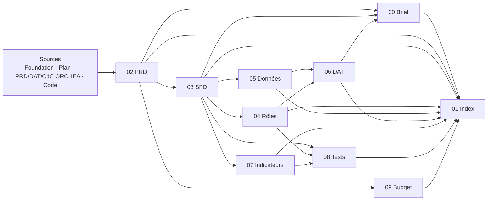

# 01 · Index des livrables · TRIVALINK ESG

| | |
|---|---|
| **Version** | 1.0 · 13 octobre 2026 |
| **Emplacement** | `trivalink/livrables/` (ce dossier) et `trivalink/docs-dev/` (documentation développeur détaillée) |
| **Code de référence** | `trivalink/app/` |
| **Statut global** | Version initiale complète, à valider par le porteur du projet |

Ce document liste tous les livrables documentaires du projet, leur rôle, leur public, leur statut et leurs dépendances. Il sert de table des matières officielle et de registre des versions.

---

## 1. Livrables standard du projet

Jeu standard de 10 documents, produit pour chaque projet ou demande de documentation.

| N° | Livrable | Rôle | Public principal | Statut | Version |
|---|---|---|---|---|---|
| 00 | [Brief de démarrage développeur](00%20-%20Brief%20de%20démarrage%20développeur%20TRIVALINK%20ESG.md) | Porte d'entrée : produit, règles d'or, pile, démarrage, première semaine | Tout nouveau développeur, assistant IA | Rédigé | 1.0 |
| 01 | Index des livrables (ce document) | Table des matières, versions, dépendances, traçabilité | Tous | Rédigé | 1.0 |
| 02 | [PRD](02%20-%20PRD%20TRIVALINK%20ESG.md) | Pourquoi, pour qui, quoi : problème, personas, exigences, priorités, roadmap | Produit, direction, développeurs | Rédigé | 1.0 |
| 03 | [SFD du MVP](03%20-%20SFD%20du%20MVP%20TRIVALINK%20ESG.md) | Comment se comporte chaque écran et chaque fonction du MVP | Développeurs, testeurs, produit | Rédigé | 1.0 |
| 04 | [Matrice des rôles et permissions](04%20-%20Matrice%20des%20rôles%20et%20permissions%20TRIVALINK%20ESG.md) | Qui peut faire quoi, sur quel périmètre | Développeurs, sécurité, clients | Rédigé | 1.0 |
| 05 | [Modèle et dictionnaire des données](05%20-%20Modèle%20et%20dictionnaire%20des%20données%20TRIVALINK%20ESG.md) | Tables, champs, contraintes, énumérations, cycles de vie | Développeurs, data | Rédigé | 1.0 |
| 06 | [DAT détaillé](06%20-%20DAT%20détaillé%20TRIVALINK%20ESG.md) | Architecture, sécurité, déploiement, exploitation, décisions | Développeurs, DevOps, sécurité | Rédigé | 1.0 |
| 07 | [Référentiel des indicateurs](07%20-%20Référentiel%20des%20indicateurs%20TRIVALINK%20ESG.md) | Les 44 indicateurs : définition, calcul, preuve, correspondances GRI / IFC | Produit, experts ESG, développeurs | Rédigé, définitions à faire valider par un expert E&S | 1.0 |
| 08 | [Plan de tests et de recette](08%20-%20Plan%20de%20tests%20et%20de%20recette%20TRIVALINK%20ESG.md) | Stratégie, cas de test, recette pilote, critères d'acceptation | Développeurs, testeurs, pilotes | Rédigé | 1.0 |
| 09 | [Budget et modèle économique](09%20-%20Budget%20et%20modèle%20économique%20TRIVALINK%20ESG.md) | Offres, prix, coûts de construction et d'exploitation, rentabilité | Direction, investisseurs | Rédigé, **montants = hypothèses** | 1.0 |

Version regroupée des 10 livrables en un seul fichier : `trivalink/TRIVALINK-livrables-00-09-complets.md`.

## 2. Documentation développeur détaillée (`trivalink/docs-dev/`)

Documentation de travail, fiche par fiche, conçue pour être donnée en contexte à un assistant de code IA.

| Fiche | Contenu | Livrable standard lié |
|---|---|---|
| README.md | Sommaire et ordre de lecture | 01 |
| 01-vision-produit.md | Vision, segment, personas, cas d'usage | 02 |
| 02-glossaire.md | Vocabulaire métier et noms du code | 00, 05 |
| 03-architecture.md | Architecture MVP et cible | 06 |
| 04-modele-de-donnees.md | Schéma et cycles de vie | 05 |
| 05-api-reference.md | 55 routes de l'API | 03, 04 |
| 06-regles-metier.md | Règles RG-xx avec code et tests | 03 |
| 07-securite-multitenant.md | Isolation, rôles, audit, chiffrement | 04, 06 |
| 08-frontend.md | Application React | 03, 06 |
| 09-referentiel-indicateurs.md | Catalogue d'indicateurs | 07 |
| 10-reporting.md | Tableau de bord et rapports | 03 |
| 11-installation-dev.md | Installation, démo, dépannage | 00 |
| 12-conventions-code.md | Conventions, recettes, revue | 00 |
| 13-tests-qualite.md | Tests | 08 |
| 14-roadmap-backlog.md | Backlog en user stories | 02 |
| 15-guide-vibe-coding.md | Méthode avec assistant IA, prompts | 00 |
| 16-deploiement-production.md | Production et exploitation | 06 |
| 17-decisions-architecture.md | ADR | 06 |
| 18-design-system.md | Identité visuelle et UX | 03 |
| CLAUDE.md | Instructions pour assistants IA (à copier à la racine du dépôt) | 00 |

Version regroupée en un seul fichier : `trivalink/TRIVALINK-documentation-dev-complete.md`.

## 3. Documents sources

| Document | Emplacement | Statut | Usage |
|---|---|---|---|
| Product Foundation TRIVALINK v0.1 | `trivalink/trivalink-product-foundation.md` | Cadrage à valider | Source principale de 02 et 07 |
| Plan produit et marque | `strategie/plan-produit-marque.md` | Recommandations | Source de 02 et 09 |
| PRD ORCHEA v1.0 | `knowledge/PRD ORCHEA – …docx.txt` | Ancien nom, vision 24 mois | Exigences, KPI produit |
| DAT ORCHEA v1.0 | `knowledge/DAT ORCHEA – …docx.txt` | Ancien nom, architecture cible | Source de 06 (cible) |
| CdC ORCHEA v1.0 | `knowledge/CdC ORCHEA – …docx.txt` | Ancien nom, base contractuelle | Exigences non fonctionnelles, critères d'acceptation |
| Code du MVP | `trivalink/app/` | Fonctionnel, 6/6 tests | Source de vérité de 03, 04, 05 |
| Captures et exemple de rapport | `trivalink/app/docs/` | À jour au 13/10/2026 | Illustrations de 03 |

**Priorité en cas de contradiction** : le code du MVP décrit ce qui existe ; la Product Foundation décrit ce qui est décidé pour le produit ; les documents ORCHEA décrivent la vision d'origine. Toute contradiction relevée doit être signalée et tranchée, puis le livrable corrigé.

## 4. Dépendances entre livrables

Règle : une modification de 02 ou 03 impose de relire les livrables en aval.

## 5. Matrice de traçabilité (extrait)

Chaque exigence du PRD est reliée à sa spécification, sa règle, son test et sa route.

| Exigence (02) | Spécification (03) | Règles (docs-dev/06) | Permission (04) | Test (08) | Route / code |
|---|---|---|---|---|---|
| EF-COL-04 Preuve obligatoire à la soumission | SF-COL-4 | RG-23 | P-COL-05 | TC-COL-03 | `POST /datapoints/:id/submit` |
| EF-COL-05 Validation à deux niveaux | SF-COL-6 | RG-24, RG-25 | P-COL-06, P-COL-07 | TC-COL-06, TC-COL-07 | `/review`, `/validate` |
| EF-RSK-04 Écart automatique sur dépassement | SF-COL-5 | RG-31 | — | TC-COL-04 | `submit` |
| EF-RSK-06 Clôture d'écart conditionnée | SF-RSK-5 | RG-34 | P-RSK-06 | TC-RSK-04 | `PATCH /incidents/:id` |
| EF-ACT-04 Résultat mesuré à la clôture | SF-ACT-4 | RG-53 | P-ACT-03 | TC-ACT-04 | `PATCH /actions/:id` |
| EF-REP-03 Rapport IFC PDF / Excel | SF-REP-3 | RG-72 | P-REP-02 | TC-REP-01..03 | `GET /reports/ifc` |
| EF-SOC-01 Isolation multi-clients | SF-SOC-1 | RG-01 | toutes | TC-SEC-01 | toutes les routes |
| EF-SOC-04 Journal infalsifiable | SF-SOC-4 | RG-70, RG-71 | P-AUD-01 | TC-SEC-05 | `audit()`, `/audit-log/verify` |
| EF-SOC-06 Saisie hors ligne | SF-COL-8 | — | — | TC-OFF-01..04 | `web/src/api.js` |

## 6. Conventions documentaires

- Nom de fichier : `NN - Titre TRIVALINK ESG.md`, numérotation continue de 00 à 09.
- Identifiants : `EF-xxx-nn` exigence fonctionnelle (02), `ENF-nn` exigence non fonctionnelle (02), `SF-xxx-n` spécification (03), `P-xxx-nn` permission (04), `TC-xxx-nn` cas de test (08), `RG-nn` règle métier (`docs-dev/06`), `ADR-nnn` décision d'architecture (06).
- Marqueurs : **[MVP]** existe dans le code ; **[À FAIRE]** prévu, absent ; **[CIBLE]** architecture à 12-24 mois ; **[HYPOTHÈSE]** chiffre à valider.
- Langue : français ; termes métier internationaux conservés (ESG, GRI, IFC, ESAP).
- Toute PR qui change un comportement met à jour le livrable concerné et incrémente sa version.

## 7. Historique des versions

| Version | Date | Auteur | Changement |
|---|---|---|---|
| 1.0 | 13/10/2026 | Équipe projet (rédaction assistée) | Création du jeu complet de 10 livrables à partir du code du MVP et des documents sources |

## 8. Points à valider par le porteur du projet

1. Les définitions et méthodes de calcul des 44 indicateurs (07) par un expert E&S.
2. Les montants du budget et de la grille tarifaire (09), à confronter aux entretiens clients.
3. Le périmètre exact du MVP pilote (02 §6 et 03) après les entretiens de découverte.
4. Le choix d'hébergement (06), après vérification de la loi guinéenne sur les données personnelles.
5. La disponibilité de la marque TRIVALINK (OAPI, classes 9, 35, 42) avant toute dépense d'identité visuelle.
