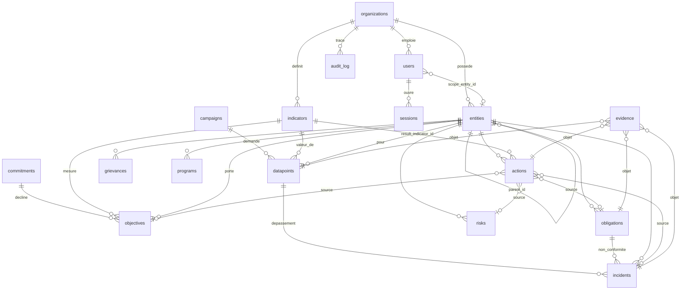
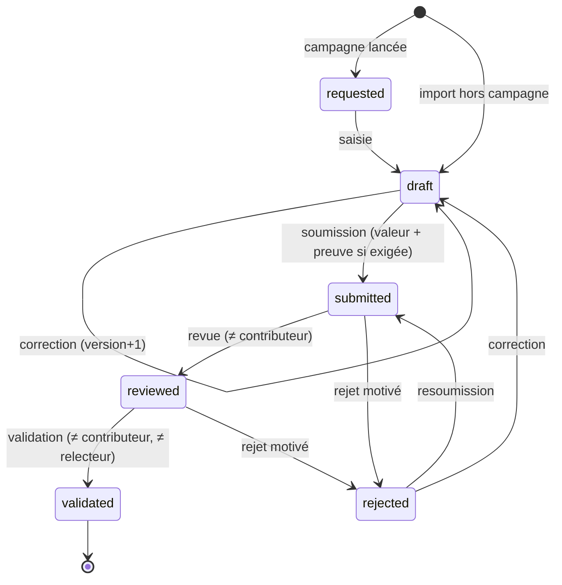

# 05 · Modèle et dictionnaire des données · TRIVALINK ESG

| | |
|---|---|
| **Version** | 1.0 · 13 octobre 2026 |
| **Statut** | Rédigé, conforme au schéma du MVP au 13/10/2026 |
| **Source de vérité** | `app/server/src/db.js` (constante `SCHEMA`), règles dans `app/server/src/modules/*.js` et `metrics.js` |
| **Documents liés** | 03 SFD, 04 Rôles (périmètres), 06 DAT (stockage, sauvegardes, portage PostgreSQL), 07 Référentiel des indicateurs, `docs-dev/04-modele-de-donnees.md` |

Ce document décrit **toutes les données que TRIVALINK enregistre** : les 18 tables, chaque colonne, ses valeurs possibles, son origine, sa sensibilité, et la façon dont elle évolue dans le temps. Il sert aux développeurs (écrire une requête juste), aux équipes data (exploiter les exports), et aux clients (répondre aux questionnaires de sécurité et de protection des données).

---

## 1. Principes de modélisation

| # | Principe | Conséquence pour le développeur |
|---|---|---|
| 1 | **Toute table métier porte `org_id`** (sauf `sessions`, rattachée via `users`) | Chaque requête filtre `org_id = req.user.org_id` (04 §1) |
| 2 | **Unicité par client** : `UNIQUE(org_id, code)` pour entités et indicateurs | Deux clients peuvent avoir chacun un site `BKN` |
| 3 | **Une seule donnée par (indicateur, entité, période)** | `UNIQUE(org_id, indicator_id, entity_id, period)` ; relancer une campagne n'écrase rien |
| 4 | **Rien ne se supprime** : aucune route `DELETE` métier | On clôt, on annule, on désactive. L'historique reste lisible par l'auditeur |
| 5 | **La valeur absente vaut `NULL`, jamais 0** | Une consolidation sans donnée validée affiche « Non disponible » |
| 6 | **Seules les données `validated` sont consolidées** | Toute requête d'agrégat filtre `status = 'validated'` |
| 7 | **Dates en texte ISO 8601, UTC** | Comparaisons lexicographiques possibles ; pas de fuseau local en base |
| 8 | **Périodes trimestrielles `AAAA-Qn`** | `'2026-Q3' > '2026-Q2'` fonctionne en SQL |
| 9 | **Énumérations par `CHECK (... IN (...))`** | Une valeur hors liste renvoie 400 « Valeur invalide » |
| 10 | **Booléens en `INTEGER` 0/1** | Les helpers de `db.js` convertissent `true/false` |
| 11 | **Liens polymorphes vérifiés par le code** | `actions.source_*` et `evidence.object_*` n'ont pas de clé étrangère SQL |
| 12 | **Champs calculés non stockés** | Score de risque, avancement d'objectif, retard d'action, résultat atteint : calculés à la lecture |
| 13 | **Schéma portable PostgreSQL** | Pas de fonction SQLite propriétaire hors `datetime('now')` (voir §9) |

## 2. Vue d'ensemble

### 2.1 Les 18 tables par domaine

| Domaine | Tables | Rôle |
|---|---|---|
| Socle | `organizations`, `entities`, `users`, `sessions` | Clients, hiérarchie, comptes, connexions |
| Référentiel | `indicators` | Catalogue des 44 indicateurs, copié par client |
| Strategy | `commitments`, `objectives` | Engagements et cibles chiffrées |
| Collecte | `campaigns`, `datapoints`, `evidence` | Demandes, valeurs, pièces justificatives |
| Risk & Compliance | `risks`, `obligations`, `incidents` | Registre des risques, obligations, écarts |
| Social | `grievances`, `programs` | Griefs des communautés, programmes communautaires |
| Governance | `policies` | Registre des politiques |
| Actions | `actions` | Plans d'action et résultat mesuré |
| Traçabilité | `audit_log` | Journal chaîné en ajout seul |

### 2.2 Diagramme entité-relation



### 2.3 La boucle centrale dans les données

```
objectives (cible)            ── indicator_id ──►  indicators
     ▲                                                 │
     │ source_type='objective'                         ▼
actions ◄── source_type='incident' ── incidents ◄── datapoints (breach=1 à la soumission)
     │                                                 ▲
     └── result_indicator_id ── mesure validée ────────┘   evidence (object_type='datapoint'|'action'|…)
```

Lire dans l'ordre : une **donnée** soumise hors seuil crée un **écart** ; l'écart reçoit une **action** ; l'action est close par une **mesure validée** de l'indicateur de résultat ; chaque étape porte ses **preuves** et laisse une ligne dans **audit_log**.

## 3. Conventions de typage

| Type logique | SQLite (MVP) | Format | Exemple | PostgreSQL cible |
|---|---|---|---|---|
| Identifiant | `INTEGER PRIMARY KEY` | entier auto | `57` | `bigint generated always as identity` |
| Horodatage | `TEXT` | `AAAA-MM-JJ HH:MM:SS` (défaut `datetime('now')`) ou ISO complet `…T…Z` | `2026-10-08T09:12:00.000Z` | `timestamptz` |
| Date métier | `TEXT` | `AAAA-MM-JJ` | `2026-12-31` | `date` |
| Période | `TEXT` | `AAAA-Qn` | `2026-Q3` | `char(7)` + `CHECK` |
| Valeur numérique | `REAL` | décimal | `5102.4` | `numeric(20,6)` |
| Montant | `REAL` | décimal, devise implicite USD | `10000` | `numeric(14,2)` + `currency` |
| Booléen | `INTEGER` | 0 / 1 | `1` | `boolean` |
| Énumération | `TEXT` + `CHECK` | valeur codée en anglais | `validated` | `CHECK` ou `ENUM` |
| JSON | `TEXT` | JSON sérialisé | `{"before":…}` | `jsonb` |

Les **valeurs codées sont en anglais** dans la base et l'API, et **traduites à l'affichage** (`web/src/i18n.js`). Ne jamais stocker un libellé français.

## 4. Dictionnaire des données

Légende des colonnes : **Obl.** = obligatoire (`NOT NULL`) · **Origine** : *saisie* (utilisateur), *système* (calculé ou posé par le serveur), *seed* (initialisation), *catalogue* (`catalog.js`) · **DCP** = donnée à caractère personnel (voir §7).

### 4.1 `organizations` — client de la plateforme

| Colonne | Type | Obl. | Défaut | Origine | Description | DCP |
|---|---|:-:|---|---|---|:-:|
| id | INTEGER PK | ✅ | auto | système | Identifiant du client, clé d'isolation reprise partout en `org_id` | |
| name | TEXT | ✅ | | seed | Raison sociale affichée (ex. « Kalaya Mining Group (démo) ») | |
| created_at | TEXT | ✅ | now | système | Date de provisionnement | |

Création : uniquement par le seed dans le MVP. [À FAIRE] console d'exploitation TRIVALINK, avec offre souscrite, pays d'hébergement, langue par défaut, devise.

### 4.2 `entities` — hiérarchie groupe → filiale → site

| Colonne | Type | Obl. | Défaut | Origine | Description | DCP |
|---|---|:-:|---|---|---|:-:|
| id | INTEGER PK | ✅ | auto | système | | |
| org_id | INTEGER FK | ✅ | | système | Client propriétaire | |
| parent_id | INTEGER FK entities | | NULL | saisie | Entité mère. NULL pour un groupe | |
| name | TEXT | ✅ | | saisie | Nom complet (« Site de Boké-Nord ») | |
| code | TEXT | ✅ | | saisie | Code court unique dans le client (« BKN »), utilisé par l'import (`entity_code`) | |
| type | TEXT enum | ✅ | | saisie | `group`, `subsidiary`, `site` | |
| country | TEXT | | | saisie | Code pays ISO 3166-1 alpha-2 (`GN`, `CI`, `SN`) | |

Contraintes : `UNIQUE(org_id, code)`. Règles serveur : filiale et site ont un parent ; le parent appartient au même client ; un site n'a pas d'enfant (RG-10, RG-11).
[À FAIRE] `active` (fermeture d'un site), `latitude/longitude` (carte), `activity` (mine, port, usine), `ownership_pct` (consolidation à la part du groupe).

### 4.3 `users` — comptes

| Colonne | Type | Obl. | Défaut | Origine | Description | DCP |
|---|---|:-:|---|---|---|:-:|
| id | INTEGER PK | ✅ | auto | système | | |
| org_id | INTEGER FK | ✅ | | système | Client de rattachement (un compte = un client) | |
| email | TEXT | ✅ | | saisie | Identifiant de connexion, **unique sur toute la plateforme**, stocké en minuscules | ✅ |
| name | TEXT | ✅ | | saisie | Nom affiché, repris dans les historiques | ✅ |
| password_hash | TEXT | ✅ | | système | `scrypt$<sel hex>$<clé hex>` ; jamais renvoyé par l'API | ✅ secret |
| role | TEXT enum | ✅ | | saisie | `org_admin`, `esg_manager`, `contributor`, `action_owner`, `executive`, `auditor` (04 §2) | |
| scope_entity_id | INTEGER FK entities | | NULL | saisie | Périmètre : NULL = tout le client, sinon l'entité et ses descendantes | |
| access_expires_at | TEXT date | | NULL | saisie | Fin d'accès, **obligatoire pour `auditor`** ; refus le lendemain | |
| lang | TEXT | ✅ | `fr` | saisie | `fr` ou `en` | |
| active | INTEGER bool | ✅ | 1 | saisie | 0 = compte désactivé, sessions supprimées | |
| created_at | TEXT | ✅ | now | système | | |

[À FAIRE] `mfa_secret` (chiffré), `last_login_at`, `failed_attempts`, `locked_until`, `phone` (relances SMS), `password_changed_at`.

### 4.4 `sessions` — connexions ouvertes

| Colonne | Type | Obl. | Description | DCP |
|---|---|:-:|---|:-:|
| token | TEXT PK | ✅ | Jeton opaque, 32 octets aléatoires en hexadécimal | ✅ secret |
| user_id | INTEGER FK | ✅ | Titulaire | |
| expires_at | TEXT ISO | ✅ | Création + 12 heures | |

Écarts : jeton stocké en clair (cible : `sha256(token)`), sessions expirées jamais purgées (cible : purge quotidienne), pas d'adresse IP ni d'agent utilisateur.

### 4.5 `indicators` — référentiel d'indicateurs

| Colonne | Type | Obl. | Défaut | Origine | Description |
|---|---|:-:|---|---|---|
| id | INTEGER PK | ✅ | auto | système | |
| org_id | INTEGER FK | ✅ | | système | **Chaque client a sa copie** du catalogue (`installCatalog`), ce qui lui permet d'ajuster seuils et activation |
| code | TEXT | ✅ | | catalogue | `E01`…`E20`, `S01`…`S17`, `G01`…`G07` ; unique par client |
| domain | TEXT enum | ✅ | | catalogue | `E` Environnement, `S` Social, `G` Gouvernance |
| category | TEXT | ✅ | | catalogue | Énergie, Eau, Climat, Déchets, Biodiversité, Santé-sécurité, Emploi, Communautés, Éthique… |
| name_fr / name_en | TEXT | ✅ | | catalogue | Libellés bilingues |
| unit | TEXT | ✅ | | catalogue | GJ, m³, tCO2e, t, ha, mg/L, %, nb, taux, USD, h |
| direction | TEXT enum | ✅ | `lower` | catalogue | Sens favorable : `lower` (moins = mieux), `higher`, `neutral` |
| aggregation | TEXT enum | ✅ | `sum` | catalogue | Consolidation sur les entités : `sum`, `avg`, `max` |
| threshold_min | REAL | | NULL | catalogue / saisie A, M | Seuil bas ; valeur strictement inférieure = dépassement |
| threshold_max | REAL | | NULL | catalogue / saisie A, M | Seuil haut ; valeur strictement supérieure = dépassement |
| gri | TEXT | | | catalogue | Correspondance GRI (ex. `GRI 303-4 · GRI 14.7`) |
| ifc | TEXT | | | catalogue | Norme de performance IFC (`NP1`…`NP8`) |
| evidence_required | INTEGER bool | ✅ | 1 | catalogue / saisie A, M | Preuve obligatoire à la soumission |
| level | TEXT enum | ✅ | `site` | catalogue | Qui fournit la donnée : `site` (sites), `group` (groupes et filiales) |
| active | INTEGER bool | ✅ | 1 | saisie A, M | Inactif = exclu des nouvelles campagnes et du tableau de bord |

Contenu détaillé des 44 indicateurs : livrable 07. [CIBLE] table `indicator_mappings(indicator_id, framework, reference, version)` pour ISSB, ESRS, SASB, référentiels nationaux ; indicateurs personnalisés par client (`is_custom`), formules (`formula`) pour les indicateurs dérivés (intensités, taux).

### 4.6 `commitments` — engagements

| Colonne | Type | Obl. | Défaut | Origine | Description |
|---|---|:-:|---|---|---|
| id, org_id | | ✅ | | système | |
| title | TEXT | ✅ | | saisie | Énoncé (« Réduire l'intensité carbone ») |
| description | TEXT | | | saisie | Détail, contexte |
| domain | TEXT enum | ✅ | | saisie | `E`, `S`, `G` |
| source | TEXT | | | saisie | Origine : « ESAP IFC », « Politique climat », « Convention minière » |
| owner_id | INTEGER FK users | | | saisie | Porteur |
| created_at | TEXT | ✅ | now | système | |

### 4.7 `objectives` — cibles chiffrées

| Colonne | Type | Obl. | Origine | Description |
|---|---|:-:|---|---|
| id, org_id | | ✅ | système | |
| commitment_id | INTEGER FK | ✅ | saisie | Engagement parent |
| indicator_id | INTEGER FK | ✅ | saisie | Indicateur qui mesure l'objectif |
| entity_id | INTEGER FK | ✅ | saisie | Entité concernée **et ses descendantes** |
| title | TEXT | ✅ | saisie | « −10 % de scope 1 d'ici fin 2027 » |
| baseline_value | REAL | | saisie | Valeur de départ |
| baseline_period | TEXT période | | saisie | Période de la valeur de départ |
| target_value | REAL | ✅ | saisie | Cible |
| target_period | TEXT période | ✅ | saisie | Échéance (`AAAA-Qn`) |

Champs **calculés à la lecture** (`objectiveStatus`, non stockés) : `current_value`, `current_period` (dernière période validée sur le périmètre), `progress` (0-100, RG-64), `met` (RG-63).

### 4.8 `campaigns` — campagnes de collecte

| Colonne | Type | Obl. | Défaut | Origine | Description |
|---|---|:-:|---|---|---|
| id, org_id | | ✅ | | système | |
| name | TEXT | ✅ | | saisie | « Collecte trimestrielle T3 2026 » |
| period | TEXT période | ✅ | | saisie | Période collectée |
| deadline | TEXT date | ✅ | | saisie | Date limite de remise |
| status | TEXT enum | ✅ | `open` | saisie | `open`, `closed`. La dernière campagne close fixe la période par défaut du tableau de bord (RG-65) |
| created_by | INTEGER FK users | | | système | Lanceur |
| created_at | TEXT | ✅ | now | système | |

Compteurs renvoyés par l'API (non stockés) : `total`, `requested` (= requested + draft + rejected), `submitted`, `reviewed`, `validated`, calculés **sur le périmètre de l'utilisateur**.
[À FAIRE] table `campaign_entities` / `campaign_indicators` pour conserver le ciblage initial, `frequency` (mensuelle, annuelle).

### 4.9 `datapoints` — valeurs d'indicateurs (cœur de la plateforme)

| Colonne | Type | Obl. | Défaut | Origine | Description |
|---|---|:-:|---|---|---|
| id, org_id | | ✅ | | système | |
| campaign_id | INTEGER FK | | NULL | système | Campagne d'origine ; NULL si créée par import hors campagne |
| indicator_id | INTEGER FK | ✅ | | système / import | Indicateur |
| entity_id | INTEGER FK | ✅ | | système / import | Entité qui fournit |
| period | TEXT période | ✅ | | système / import | Trimestre |
| value | REAL | | NULL | saisie C, A, M | Valeur dans l'unité de l'indicateur ; NULL tant que non saisie |
| comment | TEXT | | | saisie | Explication libre (« Fortes pluies, bassin B2 saturé ») |
| status | TEXT enum | ✅ | `requested` | système | `requested`, `draft`, `submitted`, `reviewed`, `validated`, `rejected` (§5.1) |
| version | INTEGER | ✅ | 0 | système | +1 à chaque modification de valeur (RG-27) |
| submitted_by / submitted_at | FK users / TEXT | | | système | Contributeur et date de soumission |
| reviewed_by / reviewed_at | FK users / TEXT | | | système | Relecteur (niveau 1) ; remis à zéro à la resoumission |
| validated_by / validated_at | FK users / TEXT | | | système | Validateur (niveau 2) |
| rejection_reason | TEXT | | | saisie A, M | Motif du rejet ; effacé à la resoumission |
| breach | INTEGER bool | ✅ | 0 | système | 1 si la valeur soumise sort des seuils (RG-30, RG-32) |

Contraintes : `UNIQUE(org_id, indicator_id, entity_id, period)`. Index : `idx_dp_org_period (org_id, period)`.
[À FAIRE] procédure de correction d'une donnée validée (nouvelle version motivée, ancienne valeur conservée), `source` (saisie, import, API, capteur), `estimated` (valeur estimée), `unit_entered` (conversion d'unités).

### 4.10 `evidence` — pièces justificatives

| Colonne | Type | Obl. | Défaut | Origine | Description | DCP |
|---|---|:-:|---|---|---|:-:|
| id, org_id | | ✅ | | système | | |
| object_type | TEXT enum | ✅ | | saisie | `datapoint`, `action`, `obligation`, `incident` | |
| object_id | INTEGER | ✅ | | saisie | Identifiant de l'objet (lien polymorphe vérifié par `objectEntity()`) | |
| filename | TEXT | ✅ | | saisie | Nom d'origine du fichier (UTF-8) | possible |
| mime | TEXT | | | système | Type déclaré par le navigateur | |
| size | INTEGER | ✅ | | système | Taille en octets (≤ 20 Mo) | |
| sha256 | TEXT | ✅ | | système | Empreinte du fichier **en clair**, affichée dans la bibliothèque (RG-73) | |
| storage_key | TEXT | ✅ | | système | Chemin relatif : `<org_id>/<16 car. du sha>-<12 hex aléatoires>.bin` | |
| uploaded_by | INTEGER FK users | | | système | Déposant | |
| uploaded_at | TEXT | ✅ | now | système | | |

Le **contenu** du fichier n'est pas en base : il est chiffré (AES-256-GCM) sur disque, au format `[IV 12 o][tag 16 o][contenu chiffré]` (06 DAT). Une preuve ne se supprime ni ne se remplace : on en ajoute une nouvelle. Index : `idx_evidence_obj (org_id, object_type, object_id)`.

### 4.11 `risks` — registre des risques

| Colonne | Type | Obl. | Défaut | Description |
|---|---|:-:|---|---|
| id, org_id | | ✅ | | |
| entity_id | INTEGER FK | ✅ | | Entité exposée |
| title | TEXT | ✅ | | « Contamination des eaux de surface par les MES » |
| category | TEXT | ✅ | | Libre : Eau, Communautés, Santé-sécurité, Gouvernance… |
| domain | TEXT enum | ✅ | | `E`, `S`, `G` |
| likelihood | INTEGER 1-5 | ✅ | | Probabilité |
| impact | INTEGER 1-5 | ✅ | | Gravité |
| mitigation | TEXT | | | Mesure d'atténuation |
| owner_id | INTEGER FK users | | | Propriétaire du risque |
| status | TEXT enum | ✅ | `open` | `open`, `mitigated`, `closed` |
| created_at | TEXT | ✅ | now | |

Calculé : `score = likelihood × impact` (1-25) ; **risque élevé si score ≥ 15 et non clos** (RG-42).
[À FAIRE] risque résiduel (probabilité et impact après atténuation), date de revue, lien vers obligations et objectifs.

### 4.12 `obligations` — obligations de conformité

| Colonne | Type | Obl. | Défaut | Description |
|---|---|:-:|---|---|
| id, org_id | | ✅ | | |
| entity_id | INTEGER FK | ✅ | | Entité soumise |
| source | TEXT | ✅ | | « ESAP IFC », « Code minier », « Permis environnemental », « Convention » |
| reference | TEXT | | | Référence dans la source (« ESAP-07 », « Art. 142 ») |
| title | TEXT | ✅ | | Énoncé de l'obligation |
| due_date | TEXT date | | | Échéance |
| status | TEXT enum | ✅ | `not_started` | `not_started`, `in_progress`, `compliant`, `non_compliant` ; `compliant` exige ≥ 1 preuve (RG-40) |
| owner_id | INTEGER FK users | | | Responsable |
| created_at | TEXT | ✅ | now | |

[À FAIRE] récurrence (obligation annuelle), date de dernière vérification, criticité.

### 4.13 `incidents` — écarts

| Colonne | Type | Obl. | Défaut | Description | DCP |
|---|---|:-:|---|---|:-:|
| id, org_id | | ✅ | | | |
| entity_id | INTEGER FK | ✅ | | Entité concernée | |
| type | TEXT enum | ✅ | | `incident`, `audit_finding`, `non_conformity`, `threshold_breach` (système uniquement) | |
| severity | TEXT enum | ✅ | `medium` | `low`, `medium`, `high`, `critical` ; `high` pour un dépassement automatique | |
| title | TEXT | ✅ | | « Dépassement de seuil : E11 … » pour un écart automatique | |
| description | TEXT | | | Récit ; peut contenir des noms de victimes ou de témoins | possible |
| occurred_at | TEXT date | ✅ | aujourd'hui | Date de survenue | |
| status | TEXT enum | ✅ | `open` | `open`, `closed` | |
| datapoint_id | INTEGER FK | | | Donnée à l'origine d'un dépassement automatique | |
| obligation_id | INTEGER FK | | | Obligation concernée par une non-conformité | |
| created_by | INTEGER FK users | | | Déclarant ; pour un écart automatique, l'utilisateur qui a soumis la donnée | |
| closed_at | TEXT | | | Date de clôture | |
| created_at | TEXT | ✅ | now | | |

[À FAIRE] cause racine, nombre de blessés, jours d'arrêt (alimentation automatique de S01-S04), classification IFC des incidents.

### 4.14 `grievances` — griefs des parties prenantes

| Colonne | Type | Obl. | Défaut | Description | DCP |
|---|---|:-:|---|---|:-:|
| id, org_id | | ✅ | | | |
| entity_id | INTEGER FK | ✅ | | Site concerné | |
| received_at | TEXT date | ✅ | aujourd'hui | Date de réception | |
| channel | TEXT | ✅ | | « Registre communautaire », « Téléphone », « Réunion villageoise », « Courrier » | |
| category | TEXT | ✅ | | Poussière, Eau, Foncier, Emploi local, Bruit… | |
| description | TEXT | ✅ | | Récit du plaignant | **✅ sensible** |
| status | TEXT enum | ✅ | `received` | `received`, `investigating`, `resolved`, `closed` | |
| resolution | TEXT | | | Réponse apportée ; obligatoire pour `resolved` et `closed` (RG-41) | possible |
| resolved_at | TEXT | | | Posée une seule fois | |

Le MVP **ne stocke pas l'identité du plaignant** dans un champ dédié. La description peut néanmoins en contenir : consigne de saisie à donner aux sites (« pas de nom, un code de registre ») et chiffrement du champ à étudier [À FAIRE].

### 4.15 `programs` — programmes communautaires

| Colonne | Type | Obl. | Défaut | Description |
|---|---|:-:|---|---|
| id, org_id | | ✅ | | |
| entity_id | INTEGER FK | ✅ | | Site porteur |
| name | TEXT | ✅ | | « Forages d'eau potable — villages riverains » |
| budget | REAL | ✅ | 0 | Budget (USD implicite) |
| spent | REAL | ✅ | 0 | Dépensé |
| beneficiaries_target | INTEGER | ✅ | 0 | Bénéficiaires visés |
| beneficiaries_actual | INTEGER | ✅ | 0 | Bénéficiaires atteints (**compte, pas de liste nominative**) |
| status | TEXT enum | ✅ | `active` | `planned`, `active`, `completed` |

### 4.16 `policies` — registre des politiques

| Colonne | Type | Obl. | Description |
|---|---|:-:|---|
| id, org_id | | ✅ | |
| title | TEXT | ✅ | « Politique HSE groupe » |
| owner_id | INTEGER FK users | | Propriétaire |
| approved_at | TEXT date | | Date d'approbation |
| review_due | TEXT date | | Prochaine revue |

Pas d'`entity_id` : une politique vaut pour tout le client. [À FAIRE] document joint (preuve), statut (projet, approuvée, retirée).

### 4.17 `actions` — plans d'action

| Colonne | Type | Obl. | Défaut | Origine | Description |
|---|---|:-:|---|---|---|
| id, org_id | | ✅ | | système | |
| entity_id | INTEGER FK | ✅ | | saisie | Entité où l'action s'exécute |
| title | TEXT | ✅ | | saisie | « Curer le bassin de décantation B2 » |
| description | TEXT | | | saisie | |
| source_type | TEXT enum | | | saisie | Origine : `incident`, `obligation`, `risk`, `objective` |
| source_id | INTEGER | | | saisie | Identifiant de l'origine (vérifié dans le client, `SOURCES`) |
| owner_id | INTEGER FK users | | | saisie | Responsable de l'action |
| due_date | TEXT date | ✅ | | saisie | Échéance |
| budget | REAL | ✅ | 0 | saisie | Budget prévu |
| spent | REAL | ✅ | 0 | saisie | Dépensé à date |
| status | TEXT enum | ✅ | `planned` | saisie | `planned`, `in_progress`, `done`, `cancelled` (§5.2) |
| progress | INTEGER 0-100 | ✅ | 0 | saisie | Avancement ; 10 au passage en cours, 100 à la clôture (RG-55) |
| result_indicator_id | INTEGER FK indicators | | | saisie | Indicateur qui prouve l'effet de l'action |
| baseline_value | REAL | | | saisie / système | Valeur de départ ; à défaut, dernière valeur validée sur l'entité (RG-51) |
| target_value | REAL | | | saisie | Valeur à atteindre |
| result_value | REAL | | | système | **Figée à la clôture** : mesure validée retenue (RG-53) |
| result_period | TEXT période | | | système | Période de cette mesure |
| closed_at | TEXT | | | système | |
| created_at | TEXT | ✅ | now | système | Son trimestre borne la mesure acceptable à la clôture |

Champs **calculés à la lecture** (`enrichAction`) : `overdue` (RG-56), `source_title`, `result { indicator_code, unit, direction, measured_value, measured_period, progress, achieved }` (RG-57).

### 4.18 `audit_log` — journal d'audit chaîné

| Colonne | Type | Obl. | Description | DCP |
|---|---|:-:|---|:-:|
| id | INTEGER PK | ✅ | Ordre d'insertion, ordre de la chaîne | |
| org_id | INTEGER | ✅ | Une chaîne par client | |
| at | TEXT ISO | ✅ | Horodatage UTC | |
| user_id | INTEGER | | Auteur (NULL pour le système) | |
| user_name | TEXT | | Nom dénormalisé, conservé même si le compte est renommé ou désactivé | ✅ |
| action | TEXT | ✅ | Voir §6.4 | |
| object_type | TEXT | ✅ | `datapoint`, `action`, `incident`, `report`, `session`, `user`… | |
| object_id | INTEGER | | Identifiant de l'objet | |
| details | TEXT JSON | | Avant/après, motif, fichier, empreinte de rapport, ligne d'import | possible |
| prev_hash | TEXT | ✅ | Hash de la ligne précédente du client, `GENESIS` pour la première | |
| hash | TEXT | ✅ | `SHA-256(org_id|at|user_id|action|object_type|object_id|details|prev_hash)` | |

Triggers `audit_log_no_update` et `audit_log_no_delete` : toute modification lève `audit_log is append-only`. Index `idx_audit_org (org_id, id)`.

## 5. Cycles de vie

### 5.1 Donnée (`datapoints.status`)



| Statut | Libellé interface | Modifiable | Compté dans le tableau de bord | Compteur campagne |
|---|---|:-:|:-:|---|
| `requested` | À fournir | ✅ | ❌ | requested |
| `draft` | Brouillon | ✅ | ❌ | requested |
| `submitted` | Soumise | ❌ | ❌ (en validation) | submitted |
| `reviewed` | Revue | ❌ | ❌ (en validation) | reviewed |
| `validated` | Validée | ❌ définitif | **✅** | validated |
| `rejected` | Rejetée | ✅ | ❌ | requested |

### 5.2 Action (`actions.status`)

| Statut | Libellé | Transitions sortantes | Qui |
|---|---|---|---|
| `planned` | Planifiée | `in_progress`, `done`, `cancelled` | A, M, responsable (sauf annulation : A, M) |
| `in_progress` | En cours | `done`, `cancelled` | idem |
| `done` | Terminée | aucune (figée) | — |
| `cancelled` | Annulée | aucune (figée) | — |

### 5.3 Écart (`incidents.status`)

`open` → `closed` si au moins une action liée et toutes terminées ou annulées (RG-34) ; `closed` → `open` (réouverture par A, M).

### 5.4 Obligation, grief, risque, programme, campagne

| Objet | Valeurs | Règle |
|---|---|---|
| Obligation | `not_started`, `in_progress`, `compliant`, `non_compliant` | Transitions libres ; `compliant` exige ≥ 1 preuve |
| Grief | `received`, `investigating`, `resolved`, `closed` | `resolved`/`closed` exigent une résolution ; `resolved_at` posé une fois |
| Risque | `open`, `mitigated`, `closed` | Libre ; un risque clos sort des « risques élevés » |
| Programme | `planned`, `active`, `completed` | Libre |
| Campagne | `open`, `closed` | Libre ; la dernière close fixe la période par défaut |

## 6. Énumérations de référence

### 6.1 Valeurs codées et libellés

| Domaine | Code | Libellé FR |
|---|---|---|
| Type d'entité | `group` / `subsidiary` / `site` | Groupe / Filiale / Site |
| Rôle | `org_admin` / `esg_manager` / `contributor` / `action_owner` / `executive` / `auditor` | Administrateur / Responsable ESG / Contributeur / Responsable d'action / Direction / Auditeur |
| Domaine ESG | `E` / `S` / `G` | Environnement / Social / Gouvernance |
| Sens favorable | `lower` / `higher` / `neutral` | À réduire / À augmenter / Neutre |
| Agrégation | `sum` / `avg` / `max` | Somme / Moyenne / Maximum |
| Niveau de collecte | `site` / `group` | Site / Groupe et filiale |
| Type d'écart | `incident` / `audit_finding` / `non_conformity` / `threshold_breach` | Incident / Constat d'audit / Non-conformité / Dépassement de seuil |
| Gravité | `low` / `medium` / `high` / `critical` | Faible / Moyenne / Élevée / Critique |
| Objet de preuve | `datapoint` / `action` / `obligation` / `incident` | Donnée / Action / Obligation / Écart |
| Origine d'action | `incident` / `obligation` / `risk` / `objective` | Écart / Obligation / Risque / Objectif |
| Langue | `fr` / `en` | Français / English |

### 6.2 Formats

| Élément | Format | Validation |
|---|---|---|
| Période | `AAAA-Qn`, n ∈ 1..4 | Expression `^\d{4}-Q[1-4]$` |
| Date | `AAAA-MM-JJ` | Date ISO |
| Code d'indicateur | `[ESG]\d{2}` | Catalogue |
| Code d'entité | texte court, majuscules conseillées | Unique par client |
| E-mail | minuscules | Unique plateforme |
| Mot de passe | ≥ 8 caractères | Haché scrypt |

### 6.3 Import CSV / Excel

| Colonne | Obl. | Correspondance |
|---|:-:|---|
| `indicator_code` | ✅ | `indicators.code` |
| `entity_code` | ✅ | `entities.code` (dans le périmètre) |
| `period` | ✅ | `datapoints.period` |
| `value` | ✅ | `datapoints.value` (décimales `,` ou `.`) |
| `comment` | | `datapoints.comment` |

### 6.4 Actions tracées dans `audit_log.action`

`provision`, `login`, `create`, `update`, `launch`, `submit`, `review`, `validate`, `reject`, `import`, `attach_evidence`, `download_evidence`, `auto_create`, `close`, `generate_report`.

## 7. Classification et protection des données

### 7.1 Niveaux de sensibilité

| Niveau | Définition | Exemples | Mesures |
|---|---|---|---|
| **Secret** | Permet l'usurpation d'un compte | `password_hash`, `sessions.token`, `TRIVALINK_STORAGE_KEY` | Jamais renvoyé ni journalisé ; hachage ; secrets hors code |
| **Confidentiel client** | Données de performance et de conformité d'un client | Valeurs, preuves, risques, écarts, rapports | Isolation par `org_id`, périmètre, chiffrement des preuves, audit |
| **Personnel** | Donnée à caractère personnel | Nom, e-mail, `user_name` du journal | Minimisation, accès limité, durée de conservation |
| **Personnel sensible** | Peut révéler une situation de vulnérabilité ou exposer une personne | Description d'un grief, description d'un incident avec blessés | Consigne de non-nomination, accès par périmètre, chiffrement du champ à étudier |
| **Public / référentiel** | Sans enjeu | Catalogue d'indicateurs, correspondances GRI/IFC | Aucune |

### 7.2 Registre des traitements (base pour la déclaration)

| Traitement | Personnes concernées | Données | Finalité | Base | Conservation proposée [HYPOTHÈSE] |
|---|---|---|---|---|---|
| Gestion des comptes | Employés du client, auditeurs externes | Nom, e-mail, rôle, périmètre | Authentification, droits | Contrat | Durée du contrat + 1 an après désactivation |
| Journal d'audit | Utilisateurs | Nom, actions, horodatages | Preuve, conformité | Obligation contractuelle et intérêt légitime | Durée du contrat + 10 ans (aligné sur les besoins d'audit des prêteurs), puis archivage |
| Gestion des griefs | Riverains, travailleurs | Récit, catégorie, canal | Mécanisme de gestion des plaintes (IFC NP1) | Intérêt légitime, obligation du prêteur | Durée du contrat client ; pseudonymisation à étudier |
| Sessions | Utilisateurs | Jeton, date | Sécurité | Contrat | 12 h, purge à mettre en place |

À valider avec un juriste au regard de la loi guinéenne sur les données personnelles et, pour les clients concernés, du RGPD (06 DAT).

### 7.3 Droits des personnes

- **Accès** : export des données d'un utilisateur (profil + actions dans le journal) [À FAIRE].
- **Rectification** : nom et e-mail modifiables par l'administrateur [À FAIRE pour l'e-mail].
- **Effacement** : impossible sur le journal d'audit (intégrité). Cible : pseudonymiser `user_name` sur demande en conservant le hash d'origine dans `details`, avec procédure documentée.

## 8. Volumétrie

### 8.1 Jeu de démonstration (mesuré le 13/10/2026)

| Table | Lignes | Table | Lignes |
|---|---:|---|---:|
| organizations | 2 | risks | 8 |
| entities | 8 | obligations | 8 |
| users | 10 | incidents | 4 |
| indicators | 88 (44 × 2 clients) | grievances | 7 |
| commitments | 5 | programs | 3 |
| objectives | 7 | policies | 4 |
| campaigns | 3 | actions | 4 |
| datapoints | 354 (118 par trimestre, T1 à T3 2026) | evidence | 316 |
| audit_log | ~1 480 | sessions | variable |

Répartition des données de démonstration : 236 `validated`, 54 `submitted`, 20 `reviewed`, 41 `requested`, 3 `draft`.

### 8.2 Projection par client [HYPOTHÈSE]

| Profil | Entités | Indicateurs actifs | Données / an (trimestriel) | Preuves / an | Lignes d'audit / an | Stockage preuves / an |
|---|---:|---:|---:|---:|---:|---:|
| Essentiel (1 site) | 2 | 30 | 120 | 120 | ~1 000 | 0,5 Go |
| Entreprise (groupe minier) | 10 | 44 | 1 500 | 1 500 | ~12 000 | 5 Go |
| Institution (programme) | 50 | 60 | 12 000 | 10 000 | ~80 000 | 30 Go |

Hypothèses : ~4 lignes d'audit par donnée (saisie, soumission, revue, validation) plus les preuves et consultations ; preuve moyenne 2 à 3 Mo. Avec 50 clients Entreprise, la base reste sous 1 Go de lignes par an : la volumétrie n'est pas un enjeu, **les preuves le sont** (stockage objet, 06 DAT).

### 8.3 Index à ajouter avant 100 000 lignes

```sql
CREATE INDEX idx_dp_ind_status ON datapoints(org_id, indicator_id, status, period);
CREATE INDEX idx_actions_entity ON actions(org_id, entity_id);
CREATE INDEX idx_actions_source ON actions(org_id, source_type, source_id);
CREATE INDEX idx_incidents_entity ON incidents(org_id, entity_id, status);
CREATE INDEX idx_risks_entity ON risks(org_id, entity_id);
CREATE INDEX idx_obligations_entity ON obligations(org_id, entity_id);
CREATE INDEX idx_audit_object ON audit_log(org_id, object_type, object_id);
```

## 9. Évolution du schéma

### 9.1 Migrations

Le MVP applique le schéma par `CREATE TABLE IF NOT EXISTS` à chaque démarrage : **une colonne ajoutée n'est pas créée sur une base existante**. Avant le premier client réel [P0] :

1. créer `server/migrations/NNN-description.sql`, numérotés et immuables une fois livrés ;
2. table `schema_migrations(version, applied_at)` ;
3. appliquer au démarrage, dans une transaction, les migrations manquantes ;
4. une PR qui modifie le schéma ajoute une migration **et** met à jour ce document.

### 9.2 Portage vers PostgreSQL

| SQLite (MVP) | PostgreSQL |
|---|---|
| `INTEGER PRIMARY KEY` | `bigint generated always as identity` |
| `TEXT` horodatage / date | `timestamptz` / `date` ; garder `period` en texte |
| `REAL` | `numeric(20,6)` (valeurs), `numeric(14,2)` (montants) |
| `INTEGER` 0/1 | `boolean` |
| `datetime('now')` | `now()` |
| Triggers `RAISE(ABORT)` | Trigger `RAISE EXCEPTION` + `REVOKE UPDATE, DELETE, TRUNCATE` sur le rôle applicatif |
| `INSERT OR IGNORE` | `INSERT … ON CONFLICT DO NOTHING` |
| `lastInsertRowid` | `RETURNING id` |
| Filtre `org_id` applicatif | + Row-Level Security `USING (org_id = current_setting('app.org_id')::bigint)` |
| Dernier hash d'audit | `pg_advisory_xact_lock(org_id)` dans la transaction d'écriture |
| `details` texte | `jsonb` |

### 9.3 Évolutions de modèle prévues

| Évolution | Tables | Phase |
|---|---|---|
| Correspondances multi-référentiels | `indicator_mappings` | Phase 2 |
| Indicateurs personnalisés et calculés | `indicators.is_custom`, `formula` | Phase 2 |
| Périodicités mensuelle et annuelle | `campaigns.frequency`, format de période étendu | Phase 2 |
| Correction d'une donnée validée | `datapoint_versions` | Phase 1 |
| Relances et notifications | `notifications`, `reminders` | Phase 1 |
| MFA et sécurité de session | `users.mfa_*`, `sessions.token_hash` | Phase 1 |
| Devise des montants | `currency` sur `actions`, `programs` | Phase 1 |
| Suivi nominatif de bénéficiaires (institutions) | `beneficiaries` avec analyse d'impact | Phase 3 |
| Ancrage externe du journal | `audit_anchors(org_id, last_id, hash, anchored_at, location)` | Phase 2 |

## 10. Requêtes de référence

```sql
-- Valeur consolidée validée d'un indicateur sur une entité et ses descendantes (périmètre déjà calculé)
SELECT SUM(d.value) FROM datapoints d
WHERE d.org_id = :org AND d.indicator_id = :ind AND d.period = :period
  AND d.status = 'validated' AND d.entity_id IN (:scope_ids);

-- File de validation d'un responsable ESG
SELECT * FROM datapoints WHERE org_id = :org AND status IN ('submitted','reviewed');

-- Écarts ouverts sans action (à relancer)
SELECT i.* FROM incidents i
WHERE i.org_id = :org AND i.status = 'open'
  AND NOT EXISTS (SELECT 1 FROM actions a WHERE a.org_id = i.org_id
                  AND a.source_type = 'incident' AND a.source_id = i.id);

-- Données validées sans preuve (taux de preuve, RG-66)
SELECT d.id FROM datapoints d
WHERE d.org_id = :org AND d.status = 'validated' AND d.period = :period
  AND NOT EXISTS (SELECT 1 FROM evidence e WHERE e.org_id = d.org_id
                  AND e.object_type = 'datapoint' AND e.object_id = d.id);
```

## 11. Historique

| Version | Date | Changement |
|---|---|---|
| 1.0 | 13/10/2026 | Création à partir de `db.js`, des modules et du jeu de démonstration |
