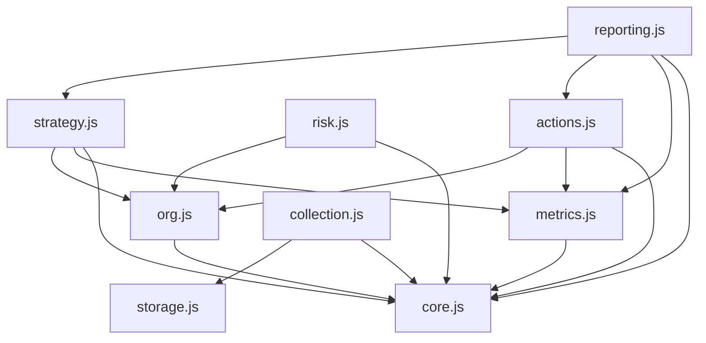
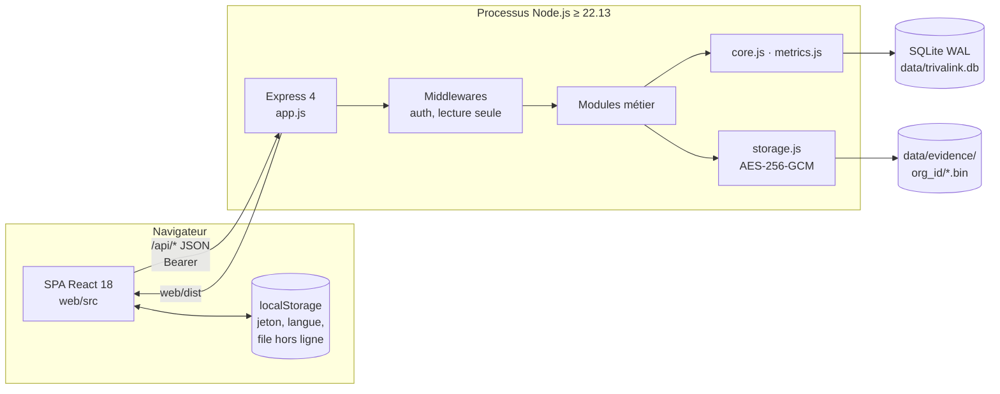
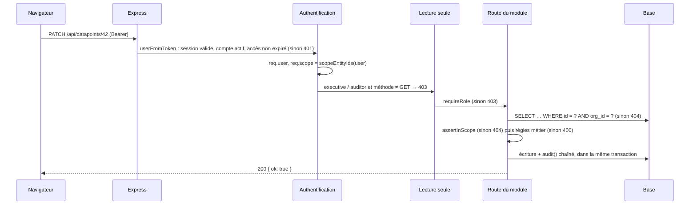
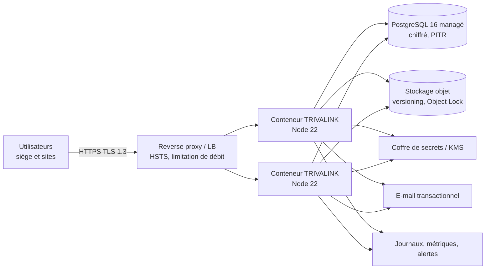
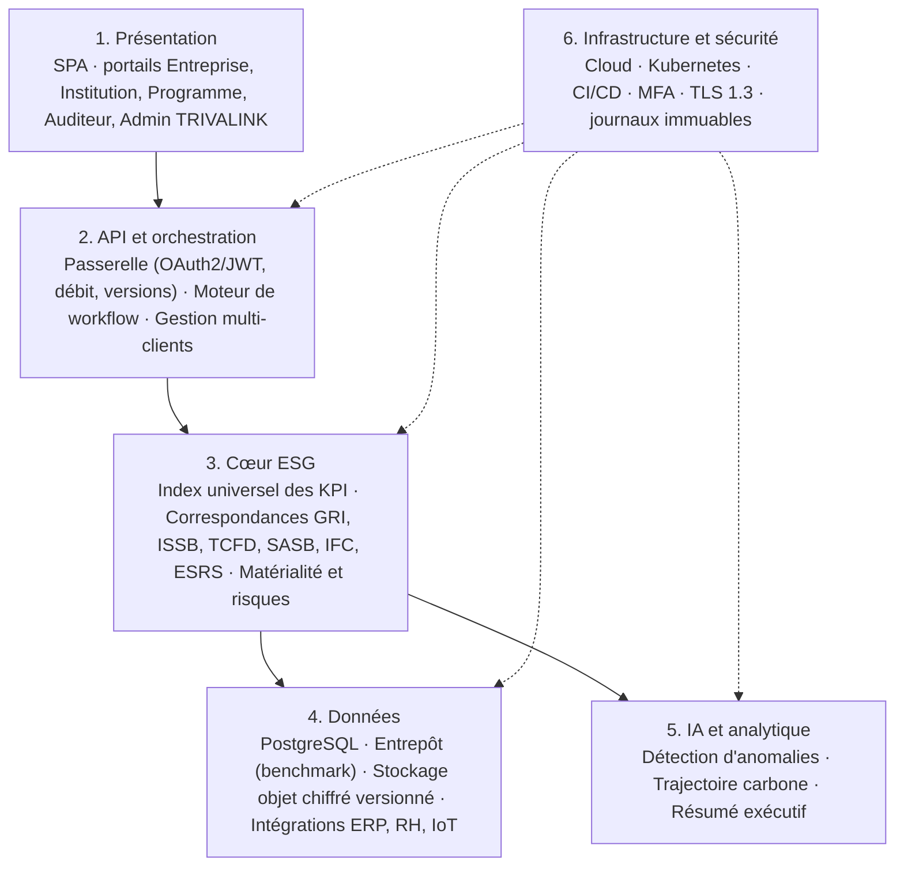

# 06 · Dossier d'architecture technique (DAT) détaillé · TRIVALINK ESG

| | |
|---|---|
| **Version** | 1.0 · 13 octobre 2026 |
| **Statut** | Rédigé. Architecture MVP : conforme au code. Architecture de production et cible : proposition à valider |
| **Remplace** | Le DAT ORCHEA v1.0 (`knowledge/`), dont la vision cible est reprise ici en §11 |
| **Documents liés** | 02 PRD (ENF-01 à ENF-14), 04 Rôles, 05 Données, 08 Tests, `docs-dev/03`, `07`, `16`, `17` |

Ce document décrit **comment TRIVALINK est construit, sécurisé, déployé et exploité**, aujourd'hui (MVP) et demain (production pilote, puis cible à 24 mois). Il consigne les décisions d'architecture (ADR) que tout développeur, humain ou assistant IA, doit respecter.

Marqueurs : **[MVP]** existe dans le code · **[T1]** requis pour le premier client réel · **[CIBLE]** horizon 12-24 mois.

---

## 1. Synthèse

| Question | Réponse |
|---|---|
| Style d'architecture | **Monolithe modulaire** : un processus Node.js, six modules métier, un socle partagé (ADR-001) |
| Multi-clients | **Isolation logique** par `org_id` dans chaque requête (ADR-002) ; RLS PostgreSQL en T2 ; base dédiée possible pour l'offre Institution |
| Base de données | SQLite intégré à Node en MVP (ADR-003) → **PostgreSQL 16 managé** en production (ADR-015) |
| Preuves | Fichiers chiffrés AES-256-GCM hors base, empreinte SHA-256 (ADR-005) → stockage objet S3 compatible en T1 |
| Traçabilité | Journal d'audit **en ajout seul, chaîné par SHA-256** par client (ADR-004) |
| Front | SPA React 18 + Vite, sans framework de routage ni d'état (ADR-008), hors ligne pour la saisie (ADR-010) |
| Rapports | Calculés à la volée depuis les seules données validées, empreinte SHA-256 (ADR-011) |
| Dépendances serveur | 4 : express, multer, pdfkit, exceljs |
| Déploiement pilote | Conteneur Node 22 derrière un reverse proxy TLS, PostgreSQL managé, stockage objet, coffre de secrets |
| Écarts bloquants avant client réel | Migrations, clé de chiffrement par défaut, MFA, limitation de débit, jeton en query string, sauvegardes (§13) |

## 2. Contexte et contraintes

### 2.1 Contexte métier

TRIVALINK sert d'abord des **groupes miniers et industriels en Guinée** qui doivent rendre compte à leurs prêteurs (IFC, banques de développement) de leur performance environnementale et sociale. Trois propriétés commandent l'architecture :

1. **Prouver** : chaque chiffre publié doit remonter à une saisie, un validateur et une pièce justificative, sans modification silencieuse possible.
2. **Isoler** : des concurrents directs partagent la plateforme ; aucune fuite n'est acceptable.
3. **Fonctionner sur le terrain** : sites miniers à connectivité faible, postes Windows hétérogènes, smartphones.

### 2.2 Contraintes

| Type | Contrainte | Effet sur l'architecture |
|---|---|---|
| Équipe | Petite équipe, développement assisté par IA | Code lisible, peu de dépendances, monolithe, règles écrites (CLAUDE.md) |
| Réseau | Connexions intermittentes sur site | File hors ligne, pages légères, uploads limités |
| Réglementaire | Loi guinéenne sur les données personnelles, RGPD pour certains clients, exigences des prêteurs | Localisation à trancher (ADR-016), journal infalsifiable, registre des traitements |
| Contractuel (CdC) | Disponibilité 99,5 %, reprise < 4 h, MFA, TLS 1.3, AES-256, couverture de tests > 80 % | Feuille de route T1 / T2 |
| Budget | Démarrage frugal | Services managés simples, pas de Kubernetes avant le besoin |

### 2.3 Exigences non fonctionnelles et réponse architecturale

| Exigence (02) | Cible | Réponse | État |
|---|---|---|---|
| ENF-01 Tableau de bord | < 3 s | Consolidation SQL indexée, une requête par indicateur sur le périmètre | [MVP] non mesuré à volume |
| ENF-02 Rapport complet | < 30 s | Calcul à la volée ; file de tâches si nécessaire [T2] | [MVP] |
| ENF-03 Chargement initial | < 2 s | SPA légère sans bibliothèque UI, build Vite | [MVP] |
| ENF-04 Disponibilité | ≥ 99,5 % | 2 instances derrière un répartiteur, base managée [T1] | [T1] |
| ENF-05 Volumétrie | 100 000 enregistrements sans dégradation | Index (05 §8.3), PostgreSQL | À tester (08) |
| ENF-06 Isolation | 100 %, prouvée | `org_id` + périmètre + tests ; RLS [T2] | [MVP] |
| ENF-07 Chiffrement | AES-256 au repos, TLS 1.3 | Preuves chiffrées ; base chiffrée managée et TLS [T1] | Partiel |
| ENF-08 MFA | Entreprise, Institution | TOTP [T1] | Absent |
| ENF-09 Accessibilité | WCAG 2.1 | Contrastes, libellés, clavier | Partiel |
| ENF-10 Langues | FR / EN | i18n à clé française | [MVP] |
| ENF-11 Données personnelles | Conformité locale | Minimisation, registre (05 §7) | À instruire |
| ENF-12 Sauvegarde | Quotidienne, reprise < 4 h | PITR + export hors région [T1] | Absent |
| ENF-13 Tests | > 80 %, multi-tenant, pentest | `node:test`, test d'isolation, pentest [T1] | Partiel |
| ENF-14 Mobile | Saisie sur tablette et smartphone | CSS responsive | [MVP] |

## 3. Vue logique

### 3.1 Domaines fonctionnels et modules

| # | Domaine | Module serveur | Tables principales | Pages front |
|---|---|---|---|---|
| — | Socle : organisation, comptes, rôles | `core.js`, `modules/org.js` | organizations, entities, users, sessions, policies | Login, Admin |
| 01 | Strategy | `modules/strategy.js` | commitments, objectives | Strategy |
| 02-04 | Environment, Social, Governance (collecte) | `modules/collection.js` | indicators, campaigns, datapoints, evidence | Collection, DataPoint, Evidence |
| 05 | Risk & Compliance | `modules/risk.js` | risks, obligations, incidents, grievances, programs | Risks |
| 06 | Reporting | `modules/reporting.js` | lecture de toutes, écriture audit seule | Dashboard, Reports, Audit |
| 07 | Actions | `modules/actions.js` | actions | Actions |
| — | Calcul | `metrics.js` | — | — |
| — | Stockage chiffré | `storage.js` | — (disque) | — |
| — | Référentiel et démo | `catalog.js`, `seed.js` | indicators | — |

### 3.2 Dépendances autorisées entre modules



Règles :

- `core.js` et `metrics.js` ne dépendent d'aucun module.
- Un module importe des **fonctions exportées** d'un autre (`ownerIn`, `objectiveStatus`, `enrichAction`, `objectEntity`), **jamais ses routes**.
- `reporting.js` lit tout et n'écrit que dans le journal d'audit.
- Aucune dépendance circulaire : une logique partagée descend dans `metrics.js` ou `core.js`.

Chaque module exporte `default (api, ctx)` et enregistre ses routes sur le routeur partagé ; `app.js` les monte sous `/api`.

### 3.3 Socle (`core.js`)

| Fonction | Rôle |
|---|---|
| `HttpError`, `bad`, `forbidden`, `notFound` | Erreurs métier uniformes `{ error, code }` |
| `MANAGERS`, `READ_ONLY`, `requireRole` | Contrôle de rôle (04) |
| `scopeEntityIds`, `assertInScope` | Périmètre : entité et descendantes |
| `audit`, `verifyAuditChain` | Journal chaîné et vérification |
| `createSession`, `userFromToken` | Sessions de 12 h, expiration des auditeurs |
| `hashPassword`, `verifyPassword` | scrypt, sel 16 octets, comparaison à temps constant |
| Utilitaires de période | `currentPeriod`, `previousPeriod`, validation `AAAA-Qn` |

## 4. Vue technique du MVP

### 4.1 Composants



### 4.2 Pile technique

| Couche | Technologie | Version | Rôle |
|---|---|---|---|
| Exécution | Node.js | ≥ 22.13 (testé 22.22) | ESM, `node:sqlite`, `node:crypto`, `node:test` |
| HTTP | Express | 4.22 | Routage `/api`, JSON (2 Mo max), statiques |
| Upload | multer | 1.4 | Fichiers en mémoire, 20 Mo max |
| Base | `node:sqlite` `DatabaseSync` | intégré | SQL synchrone, WAL, clés étrangères |
| PDF | pdfkit | 0.20 | Rapports PDF |
| Excel | exceljs | 4.4 | Import `.xlsx`, export des rapports |
| Front | React + Vite | 18.3 / 5.4 | SPA, routage par hash, i18n |
| Tests | `node:test` + `fetch` | intégré | Tests d'API de bout en bout (6/6) |

### 4.3 Arborescence

```
trivalink/app/
├── package.json           scripts : setup, build, start, test, dev:api, dev:web, reset-demo
├── server/src/
│   ├── server.js          point d'entrée
│   ├── app.js             createApp() : Express, authentification, modules, erreurs
│   ├── core.js · db.js · metrics.js · storage.js · catalog.js · seed.js
│   └── modules/           org · strategy · collection · risk · actions · reporting
├── server/test/api.test.js
└── web/src/
    ├── App.jsx · api.js · session.js · i18n.js · ui.jsx · styles.css
    └── pages/             Login, Dashboard, Strategy, Collection, DataPoint, Risks, Actions, Reports, Evidence, Audit, Admin
```

### 4.4 Cycle de vie d'une requête



### 4.5 Gestion des erreurs

| Cas | Statut | `code` |
|---|---|---|
| Règle métier, champ invalide, `CHECK` / `FOREIGN` SQL, JSON mal formé | 400 | `bad_request` |
| Pas de session, session invalide | 401 | `unauthorized` |
| Accès auditeur expiré | 401 | `expired` |
| Rôle insuffisant, séparation des tâches | 403 | `forbidden` |
| Introuvable, autre client, hors périmètre | 404 | `not_found` |
| Doublon (`UNIQUE`) | 409 | `conflict` |
| Erreur inattendue (journalisée) | 500 | `internal` |

Format unique : `{ "error": "message en français", "code": "bad_request" }`. [À FAIRE] message traduit selon `users.lang` ou clé i18n.

### 4.6 Démarrage

1. `dataDir` = `TRIVALINK_DATA_DIR` ou `app/data`.
2. `openDb` : création du dossier, WAL, schéma idempotent.
3. Si `TRIVALINK_SEED ≠ 0` et aucune organisation : jeu de démonstration (Kalaya + SIL).
4. Service de `web/dist`, repli sur `index.html` pour la SPA.
5. Écoute sur `PORT` (3000).

| Variable | Défaut | Rôle |
|---|---|---|
| `PORT` | 3000 | Port HTTP |
| `TRIVALINK_DATA_DIR` | `app/data` | Base et preuves |
| `TRIVALINK_SEED` | actif | `0` désactive la démo |
| `TRIVALINK_STORAGE_KEY` | `trivalink-dev-only-key-change-me` | Clé de chiffrement des preuves (**à imposer en production**) |

## 5. Vue des données

Modèle complet : livrable 05. Points d'architecture :

- 18 tables, toutes les tables métier portent `org_id`.
- Écriture synchrone ; transactions via `q.tx(fn)` ; l'écriture métier et sa ligne d'audit sont dans la même transaction.
- Aucune suppression métier ; le journal est protégé par triggers.
- Consolidation (`metrics.js`) : agrégation `sum`/`avg`/`max` des seules valeurs `validated` de l'entité et de ses descendantes dans le périmètre ; absence = `null`.
- Pas de migrations [MVP] → migrations versionnées [T1] (ADR-007).

## 6. Sécurité

### 6.1 Isolation entre clients

1. L'`org_id` vient de la session, jamais de la requête.
2. Chaque requête SQL métier contient `org_id = ?`.
3. Accès par identifiant : `SELECT … WHERE id = ? AND org_id = ?` puis `assertInScope`.
4. Tout identifiant reçu dans un corps est revérifié (entité, responsable, indicateur, origine d'action).
5. Preuves rangées par client (`evidence/<org_id>/…`), servies après contrôle de l'objet et du périmètre.
6. Chaîne d'audit par client.
7. Test de non-régression : le client SIL ne voit, ne lit, ne modifie, ne télécharge rien de Kalaya.

[T2] PostgreSQL **Row-Level Security** : `SET LOCAL app.org_id` en début de transaction, politique `USING (org_id = current_setting('app.org_id')::bigint)` sur toutes les tables ; test automatique qui balaie toutes les routes `GET` avec un autre client.
[CIBLE] base dédiée pour l'offre Institution ou sur exigence contractuelle.

### 6.2 Authentification et sessions

| Élément | MVP | Production |
|---|---|---|
| Mots de passe | scrypt, sel 16 o, temps constant | + politique de complexité, listes de mots de passe compromis |
| Session | Jeton opaque 256 bits en clair en base, 12 h fixes | `sha256(token)` en base, expiration glissante + absolue, purge, révocation |
| MFA | Absente | **TOTP obligatoire pour A et M, offres Entreprise et Institution** ; WebAuthn ensuite |
| SSO | Absent | OIDC / SAML pour grands comptes |
| Anti force brute | Absent | 5 essais / 15 min par compte et par IP, délai progressif |
| Mot de passe oublié | Absent | Lien unique par e-mail, 30 min |
| Jeton en `?token=` | Accepté | **Supprimé** (fetch + blob déjà utilisé par le front) |
| Énumération d'e-mails | Message identique | Conserver |

### 6.3 Autorisation

Rôles, périmètres, séparation des tâches et matrice complète : **livrable 04**. Rappel architectural : la règle de lecture seule est un middleware global (défense contre l'oubli d'un `requireRole`), le contrôle de périmètre renvoie 404.

### 6.4 Chiffrement

| Donnée | MVP | Production |
|---|---|---|
| Preuves au repos | AES-256-GCM, IV 12 o aléatoire, tag 16 o ; clé = SHA-256(`TRIVALINK_STORAGE_KEY`) ; format `[IV][tag][chiffré]` | KMS, **clé de données par client** (chiffrement d'enveloppe), rotation |
| Clé par défaut | Acceptée | **Refus de démarrer** si `NODE_ENV=production` sans clé |
| Base | Fichier non chiffré | PostgreSQL managé chiffré, sauvegardes chiffrées |
| Transit | HTTP local | TLS 1.3, HSTS |
| Intégrité des preuves | SHA-256 du clair en base | + vérification à chaque téléchargement |

### 6.5 Piste d'audit infalsifiable

```
hash_n = SHA-256( org_id | at | user_id | action | object_type | object_id | details | prev_hash )
prev_hash_n = hash_(n-1), ou "GENESIS" pour la première ligne du client
```

- Ajout seul : triggers `BEFORE UPDATE` et `BEFORE DELETE` → `RAISE(ABORT)`.
- `GET /api/audit-log/verify` recalcule la chaîne et renvoie `broken_at` à la première rupture.
- Garantie : toute altération ou suppression intermédiaire est détectée.
- Limite : un attaquant ayant un accès complet à la base pourrait réécrire toute la fin de la chaîne. Parades [T2] : ancrage quotidien du dernier hash dans un bucket en Object Lock (WORM) ; rôle SQL applicatif sans `UPDATE`/`DELETE`/`TRUNCATE` sur `audit_log` ; horodatage qualifié RFC 3161 [CIBLE].
- Concurrence : sûre en SQLite (un processus, accès synchrone). **En PostgreSQL multi-instances, sérialiser par client** avec `pg_advisory_xact_lock(org_id)`.

### 6.6 Protection applicative (OWASP)

| Risque | MVP | Production |
|---|---|---|
| Injection SQL | Requêtes paramétrées ; noms de tables seulement depuis des dictionnaires internes | Conserver la règle |
| Contrôle d'accès | Org + périmètre + rôle, tests | Balayage automatique des routes |
| XSS | React échappe, aucun `dangerouslySetInnerHTML` | CSP stricte |
| CSRF | Jeton porteur en en-tête, pas de cookie | `SameSite=Strict` + jeton CSRF si cookies |
| Upload | 20 Mo, chiffré, servi en `attachment` | Liste blanche MIME, antivirus (ClamAV) |
| En-têtes | `x-powered-by` désactivé | helmet : CSP, HSTS, `X-Content-Type-Options`, `frame-ancestors` |
| Débit | Aucune limite | Global + strict sur login et upload |
| Dépendances | 4 côté serveur | `npm audit` en CI, Renovate |
| Erreurs | 500 génériques | Journalisation structurée, identifiant de corrélation |

### 6.7 Données personnelles

Classification et registre des traitements : livrable 05 §7. Principes : minimisation (bénéficiaires comptés, pas nommés), consigne de non-nomination dans les griefs, durée de conservation, droit d'accès. Vérifier la loi guinéenne (déclaration, localisation) **avant le premier pilote**.

## 7. Front-end

| Sujet | Choix |
|---|---|
| Structure | `App.jsx` (coque, navigation `NAV` par rôle, routage par hash), `pages/*`, composants partagés `ui.jsx` |
| Session | Contexte React (`session.js`), jeton en `localStorage`, renvoi à la connexion sur 401 |
| API | `api.js` : client `fetch`, en-tête Bearer, téléchargements par blob |
| Hors ligne | Saisie, preuve (≤ 3 Mo) et soumission mises en file dans `localStorage`, rejouées dans l'ordre au retour du réseau ; le serveur reste l'arbitre (ADR-010) |
| Langues | `t('texte français')`, dictionnaire anglais dans `i18n.js` (ADR-009) |
| Styles | CSS à variables (`styles.css`), responsive, jetons de design (`docs-dev/18`) |
| Évolutions | PWA + IndexedDB pour la saisie hors ligne complète [T2] ; React Router / TanStack Query si la complexité augmente |

## 8. Reporting

- Tableau de bord et rapports calculés **à la volée** depuis les données `validated` (ADR-011).
- Formats : JSON, PDF (pdfkit), Excel (exceljs).
- Empreinte SHA-256 du contenu, date de génération exclue, imprimée sur chaque page PDF et dans l'onglet Excel ; génération tracée avec l'empreinte.
- [T2] tâches de fond pour les rapports lourds ; archivage des rapports diffusés ; signature numérique [CIBLE].

## 9. Vue de déploiement

### 9.1 Environnements

| Environnement | Usage | Données |
|---|---|---|
| Dev | Postes des développeurs | Démo (`npm run reset-demo`) |
| Staging | Recette, démos commerciales, tests de charge | Démo et jeux synthétiques volumineux, **jamais de données client** |
| Production | Pilotes puis abonnés | Données client, démo interdite |

Comptes cloud, bases, buckets, clés et secrets **distincts** par environnement.

### 9.2 Architecture pilote [T1]



Prérequis code : PostgreSQL + migrations (TL-PROD-1), stockage objet (TL-PROD-2), configuration et secrets (TL-PROD-3). Tant que le MVP reste sur SQLite : **une seule instance**.

### 9.3 Option transitoire (pilote unique encadré, SQLite)

- VM 2 vCPU / 4 Go, disque chiffré, Node 22 en service, Caddy en frontal (TLS automatique).
- `TRIVALINK_DATA_DIR` sur volume dédié ; `TRIVALINK_SEED=0` ; clé de stockage longue, aléatoire, conservée hors de la VM.
- Sauvegarde **à chaud** quotidienne (`sqlite3 trivalink.db ".backup …"`) + copie de `evidence/`, chiffrées, hors site, 30 jours, **restauration testée**.

### 9.4 Conteneur

```dockerfile
FROM node:22-alpine AS web
WORKDIR /app/web
COPY web/package*.json ./
RUN npm ci
COPY web/ ./
RUN npm run build

FROM node:22-alpine
ENV NODE_ENV=production
WORKDIR /app
COPY server/package*.json server/
RUN npm --prefix server ci --omit=dev
COPY server/src server/src
COPY --from=web /app/web/dist web/dist
RUN addgroup -S trivalink && adduser -S trivalink -G trivalink && mkdir -p /data && chown trivalink /data
USER trivalink
ENV TRIVALINK_DATA_DIR=/data TRIVALINK_SEED=0 PORT=3000
EXPOSE 3000
HEALTHCHECK CMD wget -qO- http://localhost:3000/api/health || exit 1
CMD ["node", "--disable-warning=ExperimentalWarning", "server/src/server.js"]
```

### 9.5 Configuration de production

| Variable | Obligatoire | Notes |
|---|---|---|
| `NODE_ENV=production` | oui | Active les garde-fous |
| `TRIVALINK_STORAGE_KEY` | **oui** | Depuis le coffre. **Sa perte rend toutes les preuves illisibles** : double détention, sauvegarde séparée |
| `TRIVALINK_SEED=0` | **oui** | |
| `DATABASE_URL` | après TL-PROD-1 | `sslmode=require` |
| `S3_ENDPOINT`, `S3_BUCKET`, `S3_REGION` | après TL-PROD-2 | Rôle IAM plutôt que clés statiques |
| `SMTP_*` ou clé API e-mail | relances | |
| `APP_BASE_URL` | relances | Liens dans les e-mails |

### 9.6 Hébergement (décision ouverte, ADR-016)

| Option | Pour | Contre |
|---|---|---|
| Cloud international (région Europe ou Afrique du Sud) | Services managés, fiabilité, coûts prévisibles | Données hors Guinée, refus possible de clients publics |
| Cloud régional / datacenter local (Guinée, Côte d'Ivoire, Sénégal) | Souveraineté, argument commercial | Moins de services managés, plus d'exploitation |
| Hybride : plateforme internationale, base dédiée locale pour l'offre Institution | Rejoint l'isolation hybride | Deux modes d'exploitation |

Recommandation : cloud international pour les pilotes privés si la loi guinéenne et les clients l'acceptent, option hybride préparée pour les institutions. À trancher après vérification juridique.

## 10. Exploitation

### 10.1 Sauvegarde et reprise

| Élément | Sauvegarde | Rétention | Test |
|---|---|---|---|
| PostgreSQL | PITR + export quotidien chiffré hors région | 30 jours (PITR 7 jours) | Restauration mensuelle sur staging |
| Preuves | Versioning + réplication inter-région | Durée du contrat + obligations légales | Échantillon mensuel |
| Clé de stockage | Coffre, deux détenteurs | Permanente | Vérification trimestrielle |
| Configuration | Infrastructure as code (Terraform) | — | Reconstruction trimestrielle de staging |

Objectifs : **RPO ≤ 24 h** (≤ 5 min avec PITR), **RTO < 4 h**. Runbook de reprise rédigé et testé avant le premier client.

### 10.2 Supervision

| Signal | Seuil d'alerte |
|---|---|
| `/api/health` (sonde externe) | 2 échecs consécutifs |
| Erreurs 5xx | > 1 % sur 5 min |
| Latence p95 `/api/dashboard` | > 3 s |
| Génération de rapport | > 30 s |
| `GET /api/audit-log/verify` quotidien par client | `ok: false` → **incident de sécurité** |
| Échecs de connexion | Pic anormal |
| Stockage | > 80 % |

### 10.3 Sécurité d'exploitation

TLS 1.3 et HSTS ; helmet et CSP ; limitation de débit ; MFA sur les comptes cloud et moindre privilège ; rôle PostgreSQL sans droits destructifs sur `audit_log` et RLS ; ancrage quotidien des chaînes d'audit ; antivirus sur les preuves ; mises à jour mensuelles ; **pentest avant la mise en production commerciale**, puis annuel.

### 10.4 CI/CD [T1]

| Étape | Outil proposé | Bloquant |
|---|---|---|
| Installation propre | `npm ci` | Oui |
| Tests d'API | `npm test` | Oui |
| Couverture | `node --test --experimental-test-coverage` | Seuil progressif vers 80 % |
| Audit des dépendances | `npm audit --audit-level=high` | Oui |
| Build front | `npm run build` | Oui |
| Image conteneur | Build + scan (Trivy) | Oui sur vulnérabilité critique |
| Déploiement staging | Automatique sur la branche principale | — |
| Déploiement production | Manuel, sur tag, après recette (08) | — |

### 10.5 Checklist de mise en production

- [ ] Écarts P0 (§13) traités ; TL-PROD-1 à 8 terminés.
- [ ] `NODE_ENV=production`, `TRIVALINK_SEED=0`, clé depuis le coffre.
- [ ] HTTPS valide, HSTS, en-têtes de sécurité.
- [ ] Sauvegardes actives et **restauration testée**.
- [ ] Supervision et alertes reçues par une personne d'astreinte.
- [ ] Vérification quotidienne des chaînes d'audit planifiée.
- [ ] Client provisionné, catalogue installé, seuils du client saisis (permis, ESAP).
- [ ] Premier administrateur client créé par invitation, MFA activée.
- [ ] Accord de traitement des données signé ; localisation conforme.

## 11. Architecture cible à 24 mois [CIBLE]

Reprise et mise à jour de la vision du DAT ORCHEA : une **infrastructure d'orchestration ESG multi-clients, multi-référentiels, auditable, financière et prédictive** en 6 couches.



| Service cible | Fonctions | Ancêtre dans le MVP |
|---|---|---|
| ESG Core | KPI, historisation, validation, agrégations | `collection.js` + `metrics.js` |
| Framework Mapping | Correspondances multi-référentiels, structures de rapport | colonnes `gri`/`ifc` + `reporting.js` |
| Multi-Tenant | Clients, hiérarchies, RBAC | `core.js` + `org.js` |
| Program Impact | Programmes, bénéficiaires, géolocalisation | `programs` dans `risk.js` |
| Finance & Impact Bridge | Budget ESG, dépenses, coût carbone | budget/dépensé des actions et programmes |
| Risk & Materiality | Double matérialité, scoring, alertes | `risks` 5×5, seuils |
| Audit & Compliance | Journal immuable, signature de rapports, dossier d'audit | `audit_log` chaîné, empreinte |
| AI & Predictive (Python) | Anomalies, projections, résumés | absent |

Exigences du CdC à cet horizon : 10 000 utilisateurs simultanés, 1 000 req/s à la passerelle, 100+ entreprises actives. **À n'engager que lorsque la charge réelle le justifie.**

### 11.1 Trajectoire

| Étape | Déclencheur | Changement | Ce qui ne change pas |
|---|---|---|---|
| T0 (actuel) | — | Monolithe, SQLite, disque local | — |
| T1 Pilotes en production | Premier client réel | PostgreSQL + migrations, stockage objet, secrets, sauvegardes, MFA, HTTPS, e-mails | Monolithe, modules, contrat d'API |
| T2 Entreprise (~12 mois) | 10+ clients, équipe > 5 devs | RLS, file de tâches, multi-référentiel, API `/api/v1`, OpenAPI | Monolithe probablement |
| T3 Infrastructure (~24 mois) | Charge, API publique, IA | Extraction de services (Reporting, IA Python), entrepôt, Kubernetes | Domaines fonctionnels |

**Pas de microservice avant T3** sans nouvel ADR (ADR-001).

### 11.2 Intégrations prévues

| Intégration | Usage | Phase | Mode |
|---|---|---|---|
| E-mail transactionnel | Relances de collecte, alertes d'écart | T1 | API fournisseur |
| SMS / WhatsApp | Relances terrain | T2 | Agrégateur local |
| ERP (SAP, Sage) | Dépenses, achats, énergie facturée | T2 | Export CSV puis API |
| SIRH | Effectifs, heures travaillées (S01-S05) | T2 | Import planifié |
| Capteurs / IoT | Qualité de l'eau, consommations | T3 | API d'ingestion |
| API publique TRIVALINK | Prêteurs, consolidateurs | T3 | REST versionnée, OAuth2 |

## 12. Registre des décisions d'architecture (ADR)

Toute décision structurante (dépendance majeure, changement de base, découpage en services, nouveau framework) **ajoute un ADR avant implémentation**. Un assistant IA ne contredit pas un ADR « Acceptée » sans nouvel ADR qui le remplace.

| # | Décision | Statut |
|---|---|---|
| 001 | Monolithe modulaire organisé par domaine | Acceptée |
| 002 | Isolation multi-clients logique par `org_id` | Acceptée (RLS puis hybride) |
| 003 | SQLite intégré à Node pour le MVP | Acceptée, temporaire |
| 004 | Journal d'audit chaîné SHA-256, ajout seul | Acceptée |
| 005 | Preuves chiffrées AES-256-GCM hors base | Acceptée |
| 006 | Validation à deux niveaux par trois personnes | Acceptée |
| 007 | Schéma idempotent sans migrations | Acceptée, **à remplacer avant le premier client** |
| 008 | Front React minimal | Acceptée |
| 009 | Bilinguisme à clé française | Acceptée, à revoir au-delà de ~500 libellés |
| 010 | File hors ligne côté navigateur | Acceptée |
| 011 | Rapports calculés à la volée avec empreinte | Acceptée |
| 012 | Référentiel d'indicateurs copié par client | Acceptée |
| 013 | Période trimestrielle unique | Acceptée, à étendre |
| 014 | JavaScript sans TypeScript dans le MVP | Acceptée, à revoir |
| 015 | PostgreSQL pour la production | Proposée |
| 016 | Hébergement des pilotes | Ouverte |

**ADR-001 · Monolithe modulaire.** *Contexte* : le DAT ORCHEA visait des microservices sur Kubernetes ; le PRD cite la complexité excessive du MVP comme premier risque ; équipe petite ; 3 pilotes. *Décision* : un processus Node, un module par domaine, socle partagé, dépendances par fonctions exportées. *Conséquences* : déploiement et transactions simples ; découpage futur selon les modules ; extraction d'un service soumise à un nouvel ADR (charge, équipe > 8, besoin de Python pour l'IA).

**ADR-002 · Isolation logique par `org_id`.** *Contexte* : « zéro fuite », isolation prouvée ; DAT hybride. *Décision* : `org_id` partout, issu de la session, filtré dans chaque requête, testé. *Conséquences* : coût faible ; risque d'oubli → checklist (04 §6), test de balayage, RLS en défense en profondeur ; base dédiée possible pour Institution.

**ADR-003 · SQLite pour le MVP.** *Décision* : `node:sqlite`, WAL, clés étrangères, schéma portable. *Conséquences* : une instance, accès synchrone, fonctionnalité expérimentale de Node ; remplacé par PostgreSQL en production.

**ADR-004 · Journal chaîné en ajout seul.** *Décision* : hash de la ligne précédente par client, triggers, route de vérification. *Conséquences* : détection de toute altération intermédiaire ; sérialisation par client en PostgreSQL ; ancrage externe à ajouter.

**ADR-005 · Preuves chiffrées hors base.** *Décision* : SHA-256 du clair puis AES-256-GCM, stockage par client, aucune suppression. *Conséquences* : clé unique dérivée d'une variable en MVP → KMS et clé par client en production ; stockage objet.

**ADR-006 · Validation à deux niveaux.** *Décision* : `submitted → reviewed → validated`, trois personnes distinctes. *Conséquences* : deux valideurs minimum par client ; option future d'un seul niveau pour l'offre Essentiel, par nouvel ADR.

**ADR-007 · Schéma sans migrations.** *Décision* : `CREATE TABLE IF NOT EXISTS`, réinitialisation de la démo. *Conséquences* : impossible de faire évoluer une table avec des données client ; **migrations versionnées avant tout client réel** (TL-PROD-1).

**ADR-008 · Front React minimal.** *Décision* : React 18 + Vite, routage par hash maison, contexte React, composants maison, CSS à variables. *Conséquences* : aucune dépendance front hors React ; Next.js non retenu (pas de rendu serveur nécessaire).

**ADR-009 · Bilinguisme à clé française.** *Décision* : `t('texte français')`, dictionnaire EN, données bilingues en base. *Conséquences* : rapide ; clés orphelines possibles → clés neutres et test de complétude au-delà de ~500 libellés.

**ADR-010 · File hors ligne.** *Décision* : saisie, preuve et soumission en file `localStorage`, rejouées dans l'ordre ; le serveur arbitre. *Conséquences* : 3 Mo par preuve en file, pas de lecture hors ligne ; évolution PWA + IndexedDB.

**ADR-011 · Rapports à la volée avec empreinte.** *Décision* : pas de stockage, données validées, empreinte hors date, génération tracée. *Conséquences* : reproductibilité ; une correction de donnée validée change l'empreinte suivante, ce qui est voulu ; archivage pour la signature à envisager.

**ADR-012 · Référentiel copié par client.** *Décision* : `installCatalog` copie les 44 indicateurs. *Conséquences* : personnalisation simple ; mise à jour du catalogue maître par migration ; évolution vers catalogue versionné + surcharges.

**ADR-013 · Période trimestrielle.** *Décision* : `AAAA-Qn`. *Conséquences* : suffisant pour les rapports prêteurs ; extension mensuelle et annuelle en gardant l'ordre lexicographique.

**ADR-014 · JavaScript sans TypeScript.** *Décision* : ESM JavaScript pour la vitesse. *Conséquences* : migration progressive (`// @ts-check` + JSDoc, puis `.ts`) en commençant par `core.js`, `metrics.js` et les types générés depuis OpenAPI.

**ADR-015 · PostgreSQL pour la production (proposée).** PostgreSQL 16 managé, `numeric`, `timestamptz`, `boolean`, RLS, verrou consultatif par client pour l'audit, migrations, pilote `pg` (toutes les fonctions d'accès deviennent asynchrones). *À décider* : SQLite ou PostgreSQL (Docker Compose) en développement local.

**ADR-016 · Hébergement des pilotes (ouverte).** Voir §9.6.

## 13. Dette technique et écarts à traiter

| # | Écart | Priorité | Lot |
|---|---|---|---|
| 1 | Pas de migrations de schéma | **P0** | TL-PROD-1 |
| 2 | Clé de chiffrement par défaut acceptée | **P0** | TL-PROD-3 |
| 3 | Pas de HTTPS natif | **P0** | Reverse proxy |
| 4 | Pas de limitation de débit sur la connexion | **P0** | Sécurité |
| 5 | Démo et mot de passe `demo1234` actifs par défaut | **P0** | TL-PROD-3 |
| 6 | Jeton accepté en query string | **P0** | Sécurité |
| 7 | Pas de sauvegarde ni de restauration testée | **P0** | Exploitation, TL-PROD-8 |
| 8 | MFA absente | P1 | TL-PROD-4 |
| 9 | Jetons stockés en clair, sessions jamais purgées | P1 | TL-PROD-5 |
| 10 | `GET /users` non restreint | P1 | 04 §8 |
| 11 | Pas de journal de sécurité (échecs de connexion, 403 répétés) | P1 | Observabilité |
| 12 | `PATCH /me` bloqué pour E et Au | P2 | 04 §8 |
| 13 | Moyenne simple pour les ratios (LTIFR, % femmes) au lieu d'un ratio pondéré | P1 | 07 §5 |
| 14 | Pas d'antivirus ni de liste blanche MIME | P2 | Sécurité |
| 15 | Pas d'ancrage externe de la chaîne d'audit | P2 | ADR-004 |
| 16 | Messages d'erreur serveur uniquement en français | P2 | i18n |
| 17 | API non versionnée, pas de contrat OpenAPI | P2 | `/api/v1` |

Backlog détaillé : `docs-dev/14-roadmap-backlog.md`.

## 14. Historique

| Version | Date | Changement |
|---|---|---|
| 1.0 | 13/10/2026 | Création : fusion de `docs-dev/03`, `07`, `16`, `17`, mise en regard des ENF du PRD, reprise de la cible du DAT ORCHEA |
